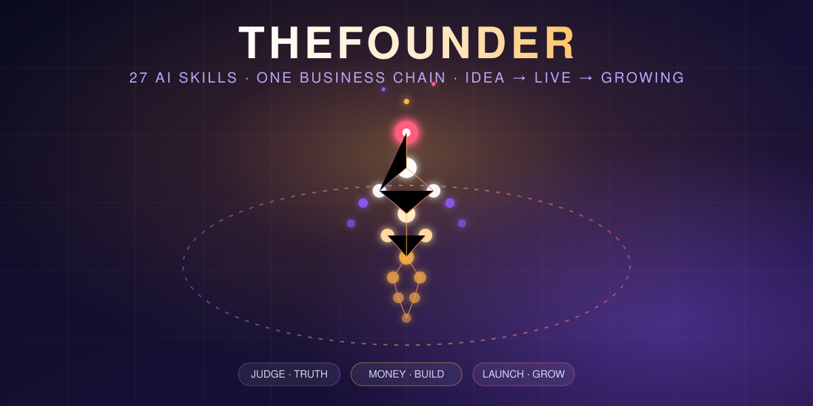
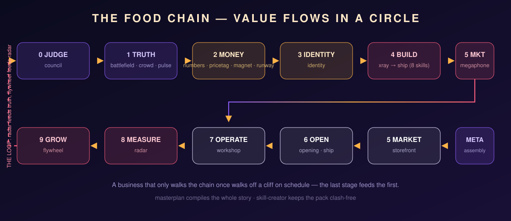

<div align="center">



# ⚡ THEFOUNDER

### **27 AI skills that take a business from a one-line idea to a live, growing product — and then keep it alive.**

**Judge the idea → learn the truth → secure the money → build the identity → rebuild any app clean-room → market → launch → operate → measure → grow → loop forever.**

[](#-the-27-skills) [](#-the-guarantees--jev-tested-not-vibe-checked) [](#-the-guarantees--jev-tested-not-vibe-checked) [](#-install-in-10-seconds) [](#-license) [](#-install-in-10-seconds)

**Works with Claude Code · Kilo · Codex · Cursor · Gemini CLI · any agent that reads a file**

</div>

---

## 🔥 Why this pack exists

Every AI skill pack gives you **fragments**. A marketing skill here, a code
skill there. Nobody ships the **whole chain** — and nobody closes the loop,
so the business you launch is a business you fly blind.

THEFOUNDER is different in three ways:

1. **It is a supply chain, not a grab bag.** 27 skills in 11 stages where
   every skill reads its sibling's output and hands off to the next.
2. **The chain is a circle.** The last stage feeds the first — what the
   radar measures becomes the next round of truth, money and growth.
3. **Every skill has a fence.** Each one states what it refuses to do and
   which sibling owns that instead — zero trigger clashes, verified by tests.

<div align="center">

</div>

---

## 🚀 Install in 10 seconds

```bash
npx thefounder init                # → ./.claude/skills   (Claude Code, project)
npx thefounder init --global       # → ~/.claude/skills
npx thefounder init --agent kilo   # → ./.kilo/skills     (Kilo)
npx thefounder init --target dir   # → any skills folder, any agent
npx thefounder doctor              # verify pack integrity (exit 1 if broken)
```

Zero dependencies. Zero API keys. Zero signups. The installer is pure
Node 18+; every script in the pack is standard-library Python 3.8+.

<details>
<summary><b>Other ways in</b> (plugin marketplace, manual copy, no harness at all)</summary>

```bash
# Claude Code plugin
/plugin marketplace add thisisniagahub/THEFOUNDER
/plugin install thefounder@thefounder

# Manual
git clone https://github.com/thisisniagahub/THEFOUNDER.git
cp -r THEFOUNDER/THEFOUNDER-* your-project/.claude/skills/

# No harness at all? Paste any single SKILL.md at the top of a chat.
# The method runs as a mode — you only lose the Python tools.
```

Full agent-by-agent matrix: [COMPATIBILITY.md](COMPATIBILITY.md)
</details>

---

## 🧬 The 27 skills

### The founder chain — idea → grow (15 skills)

| Skill | What it does |
| --- | --- |
| 🏛️ **THEFOUNDER-council** | A board of three lenses (Offers, Monopoly, Product) tears your idea apart and votes: fund, fund with conditions, or pass |
| 🗺️ **THEFOUNDER-battlefield** | Maps every competitor and the gap they leave — every claim with a public source |
| 👥 **THEFOUNDER-crowd** | 100 simulated buyers with different incomes and objections; who buys, who passes, in their own words |
| 💓 **THEFOUNDER-pulse** | What real users of the nearest app hate — reviews ranked with counts and linked quotes |
| 🧮 **THEFOUNDER-numbers** | Unit economics: margin per unit, break-even, month-by-month year one |
| 🏷️ **THEFOUNDER-pricetag** | The price buyers actually pay: price-sensitivity ranges, ladders, opening offers |
| 🧲 **THEFOUNDER-magnet** | The offer too good to refuse: solutions stacked with bonuses and an affordable guarantee |
| 🏦 **THEFOUNDER-runway** | Months of cash left, the levers that change the date, and whether/when to raise |
| 🎨 **THEFOUNDER-identity** | Name (with trademark checks), palette, logo brief, voice, tagline |
| 📣 **THEFOUNDER-megaphone** | Positioning, the channels your buyer uses, first ten hooks, dated 30-day campaign |
| 🎬 **THEFOUNDER-opening** | Cheap real-world test first, then countdown to opening day with owners and deadlines |
| 🏭 **THEFOUNDER-workshop** | Day-one operations: suppliers, SOPs, tools, licences, and the risk register |
| 📈 **THEFOUNDER-radar** | The five numbers that can kill the business; one weekly verdict: fix, push or hold |
| 🔄 **THEFOUNDER-flywheel** | The one loop that compounds — retention, referral or output — priced against your margin |
| 📜 **THEFOUNDER-masterplan** | Everything compiled into one business plan with a verdict computed from the numbers |

### The build chain — rebuild any app, clean-room (10 skills)

| Skill | What it does |
| --- | --- |
| 🩻 **THEFOUNDER-xray** | Reverse-engineers any app into a build map: screens, flows, data model, feature matrix |
| 📐 **THEFOUNDER-blueprint** | Stack, database schema, API surface, build order |
| 🎛️ **THEFOUNDER-interface** | The original's design system measured into tokens — rebuilt with your own assets |
| 🏗️ **THEFOUNDER-rebuild** | Screen by screen from the xray map, ticking off the feature matrix |
| 🔌 **THEFOUNDER-backend** | Auth, database, payments, email — through official APIs with your own keys |
| 🧪 **THEFOUNDER-trial** | Test plan from the flows, Playwright specs, bugs logged by severity until no S1/S2 |
| ⚖️ **THEFOUNDER-parity** | A weighted parity score against the original, plus the honest missing list |
| 🧹 **THEFOUNDER-rebrand** | Strips every trace of the original — including inside identifiers — and blocks the ship until the sweep is clean |
| 🏪 **THEFOUNDER-storefront** | Landing page copy, pricing page, a linted store listing |
| 🚢 **THEFOUNDER-ship** | Preflight → production → DNS records → go live, only when you say go |

### The meta layer — the pack that maintains itself (2 skills)

| Skill | What it does |
| --- | --- |
| 🎼 **THEFOUNDER-assembly** | The orchestrator: places you on the chain and hands off to exactly one next skill |
| 🛠️ **THEFOUNDER-skill-creator** | The gate for extending the pack — naming, fences, and a clash registry enforced by tests |

Deep references: [CHAIN.md](CHAIN.md) (stage map + output tree) ·
[SUB-AGENTS.md](SUB-AGENTS.md) (multi-agent topology) ·
[COMPATIBILITY.md](COMPATIBILITY.md) (agent-by-agent matrix)

---

## 🤖 From skills to a multi-agent swarm

The pack converts into **ten stage agents** — one per stage, minimal tools,
hard file-based handoffs — with `THEFOUNDER-assembly` as the conductor:

```
judge → scout → banker → designer → builder → marketer → opener → operator → analyst → grower
                ↑______________________________________________________________________|
                                   (radar feeds truth — the loop never ends)
```

Ready-to-paste frontmatter for every agent is in
[SUB-AGENTS.md](SUB-AGENTS.md) — paste into `.kilo/agents/` or
`.claude/agents/` and you have a swarm.

---

## 🧪 The guarantees — JEV-tested, not vibe-checked

Every skill is gated by a test suite that emits **JEV-style typed judgments**
(`PASS`/`FAIL`/`null` + reason code — "not computed" is `null`, never `0`,
never `false`):

```bash
bun test tests/thefounder/
# ✓ setiap skill: frontmatter, description, trigger, nama lama, python stdlib
# ✓ clash gate: tiada trigger phrase dikongsi antara skill
# ✓ fail aras pack wujud dan CHAIN.md meliputi semua skill
# ✓ laporan pack ditulis ke reports/
# 221 checks · 176 PASS · 0 FAIL · 45 NULL · 0 trigger clashes
```

| Guarantee | Enforced by |
| --- | --- |
| **Zero trigger clashes** — no two skills fight for the same command | clash gate over 136 quoted trigger phrases |
| **Every skill has a fence** — what it refuses, which sibling owns it | C04 checks + the registry in `THEFOUNDER-skill-creator` |
| **Nothing is invented** — no fake reviews, balances or metrics; unknowns stay `null`/`unmeasured` | the fences of `pulse`, `radar`, `runway` |
| **Clean-room only** — never the original's code, logo, copy or content; public surfaces + your own account | the fences of `xray`, `rebrand`'s sweep gate |
| **Stdlib-only scripts** — no pip, no network, no eval/exec | C06 import allowlist over every Python file |
| **Portable across agents** — no machine paths, no harness lock-in | C11 absolute-path scan + compatibility matrix |

---

## 💡 A real run, abridged

> **You:** clone this scheduling app, but for small teams that hate per-seat pricing.

```
THEFOUNDER-council     → verdict: fund with conditions (one risk: switching cost)
THEFOUNDER-battlefield → 9 competitors mapped, the gap: flat pricing for teams ≤ 10
THEFOUNDER-crowd       → 100 buyers: 61 buy at $12 flat; the pass reason: "trust"
THEFOUNDER-numbers     → $4.10 margin/booking · break-even: 23 bookings/day
THEFOUNDER-pricetag    → $12 flat; $29 "team" tier tests better than $19
THEFOUNDER-magnet      → offer: free migration + 90-day money-back (costs $0.9/user)
THEFOUNDER-xray        → 18 screens, 7 flows, feature matrix (must/should/could)
THEFOUNDER-blueprint   → Next.js + Postgres + Stripe; double-booking blocked in schema
THEFOUNDER-rebuild     → shell first, then the booking flow end to end
THEFOUNDER-backend     → Google Calendar + Stripe + reminders, with your own keys
THEFOUNDER-trial       → 7 flows, 34 e2e specs, 2 S1 bugs found and killed
THEFOUNDER-parity      → features 86/100, layout 91/100 — must-haves complete
THEFOUNDER-rebrand     → sweep clean: 0 traces of the original, ship unblocked
THEFOUNDER-storefront  → landing page around the angle; listing linted within limits
THEFOUNDER-opening     → waitlist test → 214 emails in 6 days → dated launch plan
THEFOUNDER-ship        → preflight green → production up → DNS records → go
THEFOUNDER-radar       → week 1: activation 71%, leak = timezone confusion → FIX
THEFOUNDER-flywheel    → team-invite loop; threshold: 1.3 invites/active team
```

Every number above traces to a file in `THEFOUNDER/` in your project.
Nothing was invented — and where something couldn't be known, it says
**unmeasured** instead of guessing.

---

## 🆚 How it compares

| | THEFOUNDER | Typical skill packs | App-clone packs |
| --- | --- | --- | --- |
| Whole business chain (idea → grow) | ✅ 11 stages | ❌ fragments | ❌ build only |
| Closes the loop (measure → grow → truth) | ✅ radar + flywheel | ❌ | ❌ |
| Clean-room build of any app | ✅ 10-skill chain | ❌ | ✅ but no business chain |
| Rebrand sweep gate before ship | ✅ enforced | ❌ | ⚠️ varies |
| Per-skill refusal fences | ✅ all 27 | ❌ | ❌ |
| Trigger-clash-free, test-verified | ✅ 0/136 overlaps | ❌ | ❌ |
| Zero-dependency installer | ✅ `npx thefounder` | ⚠️ varies | ⚠️ varies |
| Multi-agent topology included | ✅ 10 stage agents | ❌ | ❌ |

---

## ❓ FAQ

<details>
<summary><b>Is cloning apps legal?</b></summary>

The pack rebuilds **functionality and UX patterns clean-room style** — never
the original's code, assets, trademarks, copy or private APIs. It reads only
public pages and your own account. Every claim traces to a source, and
`THEFOUNDER-rebrand` blocks the ship until the sweep is clean. If your
account's terms forbid building a competitor, the pack says so and sticks to
public sources. This is not legal advice — talk to a lawyer before launch if
there is money on the line.
</details>

<details>
<summary><b>Which models does it work with?</b></summary>

Any model that can read a file and write markdown. The skills contain no
provider-specific prompts or schemas. Structure is verified for Claude,
GPT-family, Gemini, GLM and open models through any agent harness — see
[COMPATIBILITY.md](COMPATIBILITY.md).
</details>

<details>
<summary><b>Do I need the Python tools?</b></summary>

Only for exact counting and diffing (layout diff, parity score, contrast
check, brand sweep, listing lint). The methods work without them; the tools
make the verdicts exact. Standard library only — nothing to pip install.
</details>

<details>
<summary><b>Can I add my own skills?</b></summary>

Yes — that is what `THEFOUNDER-skill-creator` is for. It enforces the naming,
frontmatter, fence and clash rules, and the test suite will reject a new
skill that fights a sibling for the same triggers.
</details>

---

## 🗺️ Roadmap

- [x] 27-skill chain with zero trigger clashes
- [x] `npx` installer with integrity doctor
- [x] Multi-agent topology (10 stage agents)
- [ ] Community skill registry (PRs via `THEFOUNDER-skill-creator` gates)
- [ ] Localization of trigger phrases (BM / EN first-class)
- [ ] `thefounder doctor --json` CI action

## 📄 License

**MIT** — take it, change it, ship it. See [LICENSE](LICENSE).

<div align="center">

**If this pack saved you a month of guesswork, a ⭐ helps the next founder find it.**

</div>
