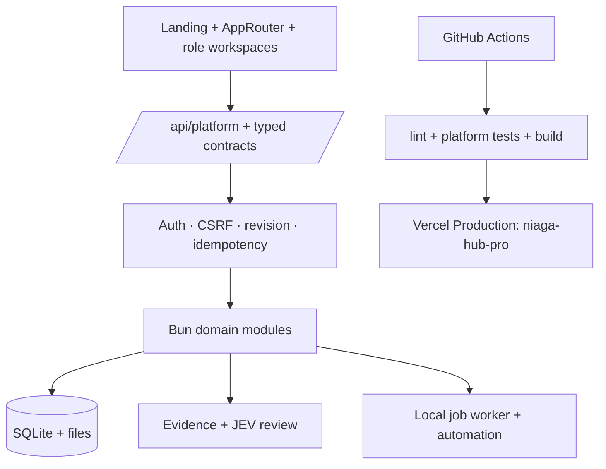

<p align="center">
  
</p>

<h1 align="center">ABANGCOLEK Platform</h1>

<p align="center">
  <strong>Operating system untuk operasi makanan, stokis, commerce, quality, marketing dan automation ABANGCOLEK.</strong>
</p>

<p align="center">
  <a href="https://vercel.com/niaga-hub-pro"></a>
  <a href="https://github.com/thisisniagahub/ABANG-COLEK-V1/actions"></a>
  
  
</p>

<p align="center">
  <a href="https://vercel.com/niaga-hub-pro">Live deployment</a> ·
  <a href="https://github.com/thisisniagahub/ABANG-COLEK-V1/actions">Actions</a> ·
  <a href="docs/README.md">Documentation index</a> ·
  <a href="docs/runbooks/platform-recovery.md">Recovery runbook</a>
</p>


> **Status:** active development. UI, typed platform contracts, local API/domain modules, role workspaces, evidence flows and CI checks are implemented. External provider integrations, production persistence and real credentials remain deployment-specific and must be verified separately.

## Apa yang dibina

ABANGCOLEK Platform menyatukan operasi harian dalam satu workspace yang boleh diaudit:

- **Public experience** — landing page, product catalogue, lokasi, bantuan dan dealer application.
- **Customer** — purchases, status, private receipts, complaints dan membership scope.
- **Staff** — assigned orders, tasks, QC, shifts, documents dan SOP.
- **Founder** — overview, approvals, stock/batch, dealers, marketing, finance, people dan settings.
- **Developer** — readiness, jobs, runtime identity, evaluations, reports dan platform settings.
- **Dealer/stokis** — approved organisation scope yang terikat kepada customer membership, bukan auth role bebas.
- **JEV/evidence** — local rules, policy, evidence, revision, receipt dan evaluation boundaries.
- **Automation** — typed contracts, adapters, local job state dan mock provider state tanpa mendakwa provider luar sudah aktif.

## Visual overview

<p align="center">
  
</p>

### Architecture



### Repository map

| Folder | Tanggungjawab |
| --- | --- |
| `src/` | React UI, AppRouter, landing, platform shell dan workspaces |
| `server/` | Bun API, domain modules, runtime identity, JEV dan automation |
| `shared/` | Typed contracts dan status schemas yang dikongsi frontend/backend |
| `public/` | Logo, brand assets, manifest dan public-only assets |
| `tests/` | Platform, JEV, integration dan browser journey tests |
| `scripts/` | Development, prerender, QA, backup dan build helpers |
| `docs/` | Source of truth, runbooks, plans dan documentation index |
| `reports/` | Research, audit, design QA dan implementation evidence |
| `var/` | Runtime database/log/files; jangan commit data operasi sebenar |

## Quick start

### Prerequisites

- Windows, macOS atau Linux
- [Bun 1.4.2](https://bun.sh/)
- Git
- SQLite runtime melalui setup projek

### Install dan run

```bash
git clone https://github.com/thisisniagahub/ABANG-COLEK-V1.git
cd ABANG-COLEK-V1
bun install --frozen-lockfile
bun run dev
```

Untuk UI sahaja:

```bash
bun run dev:ui
```

Default development surface menggunakan UI pada port `3000` dan API pada port `3010` melalui launcher projek. Jangan jalankan launcher kedua pada port yang sama atau memulakan platform dengan database kosong lalu menganggap data operasi hilang.

## Verification gates

Jalankan gates ini sebelum merge atau deploy:

```bash
bun run lint
bun run test:platform
bun run build
```

Untuk browser journeys dan QA server:

```bash
bun run test:e2e
bun run qa:server
```

Build membaca `PLATFORM_DATABASE` atau default database checkout. Jika database tiada, catalogue public boleh kosong; itu bukan bukti bahawa business catalogue production telah onboarded.

## Environment configuration

Gunakan `.env.example` sebagai rujukan. Simpan nilai sebenar hanya dalam local secret store atau Vercel Project Settings — **jangan letakkan token, password, private key atau cookie dalam README, commit, issue atau chat**.

Contoh local setup:

```powershell
Copy-Item .env.example .env.local
# Isi nilai local yang diperlukan; jangan commit .env.local
```

Credential/provider readiness mesti dibuktikan secara berasingan. Mock state, adapter contract atau local implementation tidak sama dengan integration production.

## Continuous delivery ke Vercel

Setiap push ke `main` menjalankan workflow [`.github/workflows/vercel-production.yml`](.github/workflows/vercel-production.yml):

1. checkout repository;
2. install Bun `1.4.2` dengan frozen lockfile;
3. jalankan `lint`;
4. jalankan `test:platform`;
5. jalankan production build;
6. deploy ke project Vercel **[niaga-hub-pro](https://vercel.com/niaga-hub-pro)**.

### Required GitHub secret

Tambahkan secret repository berikut di **GitHub → Settings → Secrets and variables → Actions**:

| Secret | Kegunaan |
| --- | --- |
| `VERCEL_TOKEN` | Token Vercel milik account/team yang mempunyai akses ke project `niaga-hub-pro` |

Workflow tidak menyimpan token dalam source code. Jika token pernah terdedah, revoke token lama dahulu dan cipta token baharu sebelum menambahnya ke GitHub Actions.

> **Important:** Vercel email yang memiliki `VERCEL_TOKEN` tidak perlu sama dengan email GitHub, tetapi token tersebut mesti mempunyai akses kepada project/team yang betul.

## Security dan data boundaries

- Jangan commit `.env`, token, cookies, database production, browser profile, cache atau generated runtime artifacts.
- Semak perubahan dengan `git diff --check` dan `git status` sebelum commit.
- Role, organisation membership, revision, idempotency dan evidence boundary hendaklah disahkan di backend.
- First-party documents/tasks/calendar bukan Google records automatik.
- Google, Supabase, WhatsApp, Postiz dan provider AI legacy tidak dianggap synced atau aktif tanpa proof khusus.
- Sebelum external execution, sahkan rights, approval, credentials dan zero-new-spend.

## Documentation starting points

- [Documentation index](docs/README.md)
- [Source of truth](docs/ABANGCOLEK-SOURCE-OF-TRUTH.md)
- [Platform status](docs/ABANGCOLEK-PLATFORM-STATUS-2026-10-16.md)
- [AI agent architecture](docs/AI-AGENT-ARCHITECTURE.md)
- [Capability matrix](docs/handover/CAPABILITY-MATRIX.md)
- [Platform recovery runbook](docs/runbooks/platform-recovery.md)
- [JEV architecture and rules](JEV.md)
- [Research index](reports/research/2026-10-02/README.md)

## Contributing

1. Cipta branch kerja daripada `main`.
2. Kekalkan perubahan kecil dan boleh diaudit.
3. Tambah atau kemas kini tests untuk behaviour baharu.
4. Jalankan lint, platform tests dan build.
5. Semak secrets, generated files dan database sebelum commit.
6. Buka pull request dengan ringkasan, evidence dan risiko deployment.

## License

Status license dan hak penggunaan assets perlu disahkan oleh pemilik projek sebelum public redistribution. Brand assets dalam repository adalah untuk penggunaan ABANGCOLEK Platform sehingga dinyatakan sebaliknya.
