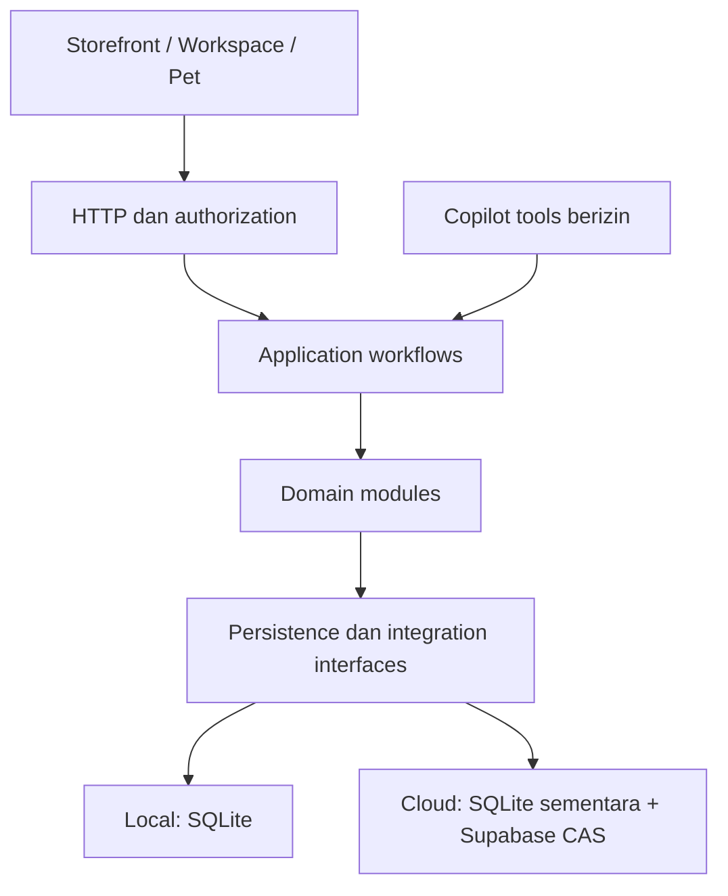

# AbangColek Sovereign GrowthOS & Orbit — Master Blueprint v2.4

<!-- ABANGCOLEK-CURRENT-STATUS:BEGIN -->
> **Alignment20Oktober2026:** [Status semasa](CURRENT-STATUS.md) · [Checklist](../PROJECT-CHECKLIST.md). Kontrak sasaran kekal di bawah blueprint v2.4; scope reka bentuk dan keputusan tetap bukan bukti semua fungsi telah diimplementasi. Semak status per-ID dan environment sebelum mendakwa siap atau production-ready.
<!-- ABANGCOLEK-CURRENT-STATUS:END -->

**Versi:** 2.4 — kontrak pelaksanaan tetap, coverage penuh dan gates berbukti.
**Tarikh semakan:** 21 Oktober 2026 — amendment Commerce & Growth; versi kontrak kekal v2.4.
**Status:** Rujukan reka bentuk untuk pembangunan; implementasi, migrasi folder dan kesediaan production memerlukan bukti berasingan.  
**Prinsip:** Rules Own The Money; domain modules; contribution margin; durable transactions; tiada caj inference baharu tanpa kebenaran; evidence sebelum dakwaan siap.

## 1. Tujuan, skop dan autoriti

ABANGCOLEK menggabungkan empat kemampuan:

1. **Operations Core:** stok fizikal, lot/luput, QC botol bocor, konsainan, cawangan dan day-close.
2. **Commerce & Dealer Network:** storefront, checkout, pesanan, pembayaran, restock dan komisen ejen.
3. **Orbit:** loyalty dan referral pelanggan satu peringkat dengan kawalan margin dan penyalahgunaan.
4. **Operations Copilot:** bantuan berdasarkan rekod berizin, JEV, draf tindakan, approval serta Pet/voice sebagai UI pilihan.

Dokumen ini menetapkan kontrak sasaran. Ia bukan pengesahan semua fungsi siap, semua ujian lulus, integrasi luar aktif atau pematuhan undang-undang. Nama class, jumlah test lama dan ringkasan chat bukan bukti production.

### 1.1 Sumber dan baseline

- [Source of Truth](ABANGCOLEK-SOURCE-OF-TRUTH.md): source, runtime dan boundaries.
- [Struktur repo sasaran](design/repository-structure.md): pemetaan fail, dependency dan peringkat migrasi.
- [Keputusan implementasi tetap](decisions/0003-blueprint-v23-execution-contract.md): pilihan stack, model, protokol dan fallback tanpa keputusan seni bina diserahkan kepada pelaksana.
- [Prompt implementasi utama](prompts/IMPLEMENT-ABANGCOLEK.md): arahan lengkap dan fasa pelaksanaan; bukan bukti tugas sudah selesai.
- [Kontrak pelaksanaan agent](prompts/AGENT-EXECUTION-CONTRACT.md): ownership, budgets, skills, plugin/MCP manifest, keputusan kewangan deterministik dan failure actions.
- [Register acceptance](prompts/ACCEPTANCE-REGISTER.md): 78 requirement teras dan ekstensi CopilotKit yang digate secara berasingan; bukan jumlah tests.
- [Checklist projek](../PROJECT-CHECKLIST.md): paparan dijana daripada ledger; integrator merekod receipt/status sah, menjalankan verifier kemudian renderer selepas task. Jangan edit generated ticks/counters secara manual.
- [Review terperinci 20 Oktober](../reports/blueprint-review-20261020.md): dapatan, metadata dependency, sumber primer dan batas review dokumentasi.
- [Research GitHub](research/2026-10-19-github-project-structure.md): sumber primer dan commit pin Bulletproof React, Medusa, CopilotKit, Hono dan Google ADK TypeScript.
- [Review pemuktamadan](handoffs/2026-10-19-blueprint-finalization-review.md): review chat Antigravity `80abddbc-37fb-472e-ac65-d96784cc5832` serta source.
- [Production runbook](production-release.md) dan [recovery runbook](runbooks/platform-recovery.md): prosedur operasi; konflik perlu diselesaikan melalui ADR sebelum release.

Baseline v2.3 dahulu ialah `56bfa93` bersama dirty worktree. Review v2.4 membaca root branch integrasi `60311aa` bersama dirty changes dan membandingkan release `main` `e736856`. Worktree frontend/backend dan integrasi yang terputus mempunyai diff berasingan. Nilai ini snapshot audit, bukan arahan checkout/reset. HEAD sahaja tidak mewakili semua fail yang dibaca; pelaksana mesti merekod manifest semasa. Tiada suite aplikasi, model call, migrasi atau deployment dijalankan sebagai sebahagian review dokumen v2.4 ini; evidence release terdahulu tidak menutup acceptance Copilot.

Jika sasaran bercanggah dengan implementasi, rekodkan jurang. Mengemas kini blueprint tidak bermaksud source, schema atau data sudah dimigrasikan. Rujukan dalam dokumen ini menggunakan path semasa; kemas kini bersama pemindahan sebenar.

### 1.2 Di luar skop MVP

Multi-tenant SaaS, pemasangan aplikasi native wajib, wallet top-up/cash withdrawal, referral berbilang tingkat, perubahan polisi kewangan melalui pembelajaran autonomi dan migrasi framework menyeluruh ditangguhkan. Pemasangan SDK atau pembelian perkhidmatan bukan kesan automatik blueprint ini. Lima tingkat dan kadar MadConomy Ahmad’s ialah perbandingan research sahaja, bukan polisi ABANGCOLEK.

## 2. Prinsip operasi dan kos

### 2.1 Rules Own The Money

Harga, stok, pembayaran, komisen, refund dan ganjaran dikawal kod deterministik pada server. Command memerlukan input sah, principal semasa, scope, revision, versi polisi, idempotency dan audit yang sesuai.

`store.atomic(...)` ialah mekanisme transaksi tempatan semasa. Pada runtime cloud, transaksi SQLite sahaja belum membuktikan durable commit; CAS mesti berjaya sebelum mutasi dianggap sah. Order/payment/inventory/commission/loyalty yang berkaitan mengekalkan satu unit transaksi. AI tidak mendapat akses bebas untuk mengubah database.

### 2.2 Web-first dan offline

Pelanggan boleh membeli melalui web tanpa wajib memasang aplikasi. Draf offline ialah data pada peranti, bukan order diterima server atau reservation stok.

- Draf boleh berstatus `local_draft`, `pending_sync`, `needs_review`, `submitted` atau `failed`.
- Reconnect mengesahkan sesi, catalogue version, harga, voucher, stok dan loyalty semula.
- Perubahan harga/jumlah memerlukan semakan pelanggan sebelum submission.
- Retry menggunakan idempotency key stabil untuk payload sama; payload berubah memerlukan submission baharu.
- Draf diasingkan mengikut akaun/workspace, mempunyai retention dan tidak dihantar menggunakan akaun lain selepas logout/login.
- Cache tidak boleh mendedahkan token sesi atau data peribadi pengguna sebelumnya.

### 2.3 Polisi kos

MVP mengelakkan langganan cloud tetap baharu yang tidak diperlukan. Kos domain, hardware, payment gateway, mesej, OTP, storage dan network tetap direkodkan.

Polisi AI sasaran: **tiada caj inference baharu tanpa kebenaran eksplisit**. Provider/model hanya diaktifkan selepas kelayakan akaun, quota dan batas kos disahkan. Label `free`, nama provider atau langganan coding assistant tidak membuktikan API percuma. Failover kepada model berbayar secara senyap dilarang.

Jika provider yang dibenarkan tidak tersedia, pulangkan fallback tempatan berlabel atau `unavailable`. Register provider menyimpan sumber, tarikh semakan, quota, had penggunaan dan keputusan activation.

Kos WhatsApp mengikut kategori, pasaran, mesej delivered dan caj provider yang terpakai; jangan gunakan andaian per-conversation lama. [Rujukan harga rasmi Meta](https://whatsappbusiness.com/products/platform-pricing/). Had hosting/database dan polisi pausing mesti disemak untuk plan sebenar sebelum release; recovery tidak boleh bergantung pada andaian free tier sentiasa tersedia.

## 3. Seni bina dan authority data

### 3.1 Modular monolith

Kekalkan React/Vite, Bun, domain services, shared contracts dan adapter runtime dalam satu aplikasi. Ini adaptasi pola GitHub kepada source tempatan. Struktur folder dan populariti upstream tidak menjamin kestabilan production; sempadan dependency, transaksi dan verification perlu dikuatkuasakan.



### 3.2 Dua runtime

| Aspek | Tempatan | Cloud semasa dalam source |
|---|---|---|
| Entry | `server/index.ts` | `api/platform.ts` dan nested entry |
| Data kerja | SQLite melalui backend tempatan | SQLite sementara dihydrate daripada snapshot |
| Authority commit | Transaksi SQLite pada store dipilih | Revision CAS PostgreSQL melalui snapshot repository |
| Evidence | Storage yang dikonfigurasikan | Adapter private evidence storage |
| Lifecycle | Proses boleh kekal hidup | Request/worker; disk dan timer bukan jaminan kekal |
| Recovery | Restore database bersama evidence | Snapshot aktif memerlukan backup sejarah dan evidence berasingan |

Rujukan source: `server/platform/supabasePersistence.ts`, `api/platform.ts` dan `server/platform/evidenceFiles.ts`. Ini pemerhatian source, bukan pengesahan deployment terkini.

CAS mengawal revision supaya perubahan lain tidak ditindih. Ia bukan backup sejarah atau native PostgreSQL domain schema. Whole-snapshot ialah compatibility backend dengan batas saiz, latency dan concurrency yang perlu diukur. Perubahan authority memerlukan ADR, migrasi dan cutover tersendiri.

### 3.3 Commit, retry dan side effects

- Mutasi gagal CAS tidak dilaporkan berjaya atau diulang secara membuta tuli.
- Retry memerlukan receipt dan idempotency yang kekal.
- Publish, mesej dan payout menggunakan intent durable, dedupe provider serta reconciliation. Kegagalan snapshot tidak membenarkan penghantaran luar berulang. Outcome tidak pasti menjadi `unknown_outcome`.
- Streaming tidak boleh mendakwa approval/mutasi berjaya sebelum durable commit. Uji disconnect, timeout dan konflik CAS.
- Job memerlukan claim, lease dan retry yang sesuai dengan runtime. Timer in-process tidak menjamin jadual serverless.

## 4. Struktur repo sasaran

Struktur berikut belum dipindahkan oleh kemas kini ini. [Spesifikasi struktur](design/repository-structure.md) mengandungi pemetaan fail dan exception migrasi.

```text
api/                         Entry point hosting yang stabil
src/
  main.tsx
  app/                       Router, layouts, providers, global styles
  features/                  Auth, onboarding, landing, storefront, orders,
                             inventory, dealers, loyalty, marketing,
                             operations, collaboration, reports, settings,
                             copilot, jev, automation, pet
  components/                UI generik
  lib/                       HTTP client dan presentation helpers
  integrations/              Integrasi client-safe
  assets/
  legacy/                    Compatibility yang masih mempunyai caller
server/
  index.ts
  bootstrap/                 Composition, config dan runtime identity
  http/                      Routes, middleware dan error mapping
  application/               Workflow rentas domain
  modules/                   Rules dan services domain
  agents/                    Copilot, providers, tools, approvals, sessions
  infrastructure/            Persistence, evidence, backups, integrations
  automation/                Queue dan job orchestration
  legacy/
shared/                      Contracts, pure validation dan constants
tests/                       Unit, integration, architecture, fixtures, E2E
scripts/                     Dev, build, ops dan maintenance
supabase/                    SQL dan konfigurasi
public/                      Aset yang sengaja diterbitkan
docs/                        Architecture, product, decisions, runbooks,
                             design, research, handover, archive, plans
reports/                     Evidence bertarikh dan eksport laporan
references/                  Media asal dan presentation exports
skills/                      Skill repo
var/                         Data runtime yang diabaikan Git
```

### 4.1 Aturan dependency

1. App menggabungkan feature; feature tidak mengimport app atau internals feature lain.
2. HTTP/session client berada dalam `src/lib/http`; data access tidak bergantung pada router.
3. Frontend tidak mengimport server. Shared code tidak mengimport UI, storage SDK atau secrets.
4. Routes memanggil workflow/query; pricing dan ledger rules berada dalam domain modules.
5. Workflow menyelaraskan domain melalui interface dan satu transaction context.
6. Vendor transports/storage dipasang di composition root; domain tidak bergantung pada HTTP handler.
7. AI tools melalui command dan authorization canonical yang sama seperti UI manusia.
8. Gunakan direct imports dan module entry point kecil yang disengajakan; elakkan broad barrels.
9. Wujudkan folder apabila ada fail sebenar; tiada template berlapis wajib bagi setiap modul kecil.
10. Checker dependency/cycles mesti memahami TypeScript aliases dan re-exports, mempunyai negative tests dan legacy exception register.

Kekalkan discovery root Vite/Vercel/TypeScript dan `api/` ketika migrasi awal. Periksa casing Linux, relative assets, `import.meta.dir`, test discovery serta working directory scripts. Jangan pindahkan database hidup, credentials, browser profiles atau direktori tool-managed.

## 5. Margin Guardian dan unit kewangan

Semua wang disimpan sebagai integer sen; peratus polisi menggunakan basis points. RM/peratus ialah paparan. Rounding, allocation dan versi polisi mesti eksplisit.

```text
contribution_sen = net_sales_ex_tax_sen
  - cogs_sen - packaging_sen - payment_fees_sen
  - fulfilment_variable_cost_sen - delivery_net_cost_sen
  - agent_commission_sen - reward_incremental_cost_sen
  - expected_return_loss_sen

contribution_margin_pct = 100 * contribution_sen / net_sales_ex_tax_sen
```

Net sales <= 0 menghasilkan `insufficient_data` atau `blocked` mengikut sebab; ratio tidak boleh digunakan untuk meluluskan promosi.

| Komponen | Kontrak sasaran |
|---|---|
| Net sales | Hasil item selepas diskaun/refund yang diperuntukkan, tidak termasuk cukai dan hasil shipping; denominator KPI ini ialah hasil item |
| COGS / packaging | Ditolak sekali; packaging yang sudah termasuk COGS tidak ditolak semula; pemulihan nilai stok hanya selepas receiving/QC mengesahkan boleh jual semula |
| Payment / fulfilment | Bezakan kos unjuran/sebenar; allocation line mengekalkan jumlah; fulfilment di sini tidak termasuk carrier atau packaging yang sudah diletakkan dalam bucket lain |
| Delivery net cost | Kos carrier sebenar/unjuran ditolak hasil shipping bersih yang dicaj kepada pelanggan, kedua-duanya tanpa cukai; boleh negatif jika shipping menghasilkan lebihan |
| Commission | Item layak dan versi polisi asal |
| Reward cost | Kos incremental belum dikira dalam diskaun/net sales; elak double counting |
| Return loss | Anggaran polisi berversi, dibezakan daripada refund sebenar |

Simulasi menyimpan input/provenance, versi kos, catalogue version dan masa pengiraan. Server tidak mempercayai nilai margin daripada client atau kad AI.

Eligibility mesti dibandingkan sebelum rounding: `contributionSen * 10000 >= netSalesExTaxSen * minimumMarginBps`, dengan integer arithmetic yang selamat/BigInt. Paparan25.00% tidak meluluskan raw24.996% apabila minimum2500bps. Gunakan satu implementation canonical; wrapper client/shared tidak menduplikasi formula. Allocation wang menggunakan largest remainder, floor dahulu, residual mengikut pecahan menurun dan tie-break stable line ID menaik; jumlah allocation sama dengan jumlah input. Historical authoritative allocation/versi asal tidak dikira semula dengan polisi baharu. Nilai komersial/rates mesti datang daripada polisi diluluskan; algorithm allocation ini tidak menetapkan entitlement refund atau kadar reward.

Kontrak shipping tunggal: `delivery_net_cost_sen = carrier_cost_sen - shipping_revenue_ex_tax_sen`. Carrier tidak ditolak sekali lagi sebagai fulfilment, dan hasil shipping tidak ditambah sekali lagi kepada net sales item. Contoh: hasil item 10,000 sen, carrier 800 sen dan hasil shipping 500 sen memberikan delivery net cost 300 sen. Jika semua kos lain 7,000 sen, contribution ialah 2,700 sen dan ratio 27%. Ini KPI contribution berasaskan hasil item; laporan hasil keseluruhan yang termasuk shipping menggunakan label dan denominator berasingan. Nama lama `delivery_subsidy_sen` perlu dipetakan secara eksplisit; jangan menukar makna medan source sedia ada secara senyap.

Untuk `estimated`, expected return loss mewakili kerugian masa depan yang belum direalisasi. Untuk `actual`, refund berjaya sudah mengurangkan net sales, fee/carrier tidak dipulangkan kekal dalam bucket kos masing-masing, dan COGS hanya dikurangkan dengan nilai stok yang benar-benar dipulihkan selepas QC. Bahagian expected loss yang berkaitan return/refund direalisasi dilepaskan, bukan ditolak lagi. Baki expected loss hanya meliputi exposure belum selesai; selepas exposure ditutup nilainya sifar. Contoh: jualan item 10,000 sen, COGS 4,000 sen dan expected loss 500 sen memberi estimated contribution 5,500 sen sebelum kos lain. Selepas refund penuh tanpa stok boleh dipulihkan, net sales sifar, COGS kekal 4,000 sen dan reserve dilepaskan: actual contribution -4,000 sen, bukan -4,500 sen; ratio tidak digunakan. Jadual reconciliation menyimpan perubahan anggaran, refund dan pemulihan COGS mengikut order/line supaya tiada double counting.

Kempen disekat jika contribution amount **atau** ratio kurang daripada minimum, atau input kos wajib tidak tersedia. Founder override memerlukan role, sebab, skop, expiry, versi simulasi dan audit. Ia tidak memintas stok, bukti bayaran atau integriti ledger.

Contoh acceptance, bukan data sebenar: net sales 10,000 sen dan kos 8,000 sen menghasilkan contribution 2,000 sen serta 20%. Minimum amount 1,500 sen lulus tetapi minimum ratio 25% gagal; kempen disekat tanpa override sah. Redemption 500 sen yang sudah mengurangkan net sales tidak ditolak lagi sebagai reward cost yang sama.

Contribution margin bukan untung bersih. Bezakan `estimated` sebelum jualan daripada `actual` selepas fulfilment dan nyatakan kos yang belum diketahui.

## 6. State machine, lejar dan refund

Nama berikut ialah vocabulary sasaran; petakan kepada enum semasa sebelum migrasi. Dokumentasi tidak menukar enum data lama. Setiap transition memerlukan event, actor, revision, guard, idempotency dan effect.

| Domain | Transition secara konsep | Guard / batas |
|---|---|---|
| Order | `placed -> confirmed -> processing -> completed`; pembatalan dari keadaan layak | Pickup/delivery melalui fulfilment; delivered tidak menjadi cancelled |
| Payment attempt | `created -> pending`; `pending -> paid/failed/expired/cancelled` | Bukti sah; callback lewat tidak menurunkan paid |
| Refund request | `requested -> approved/rejected`; `approved -> processing`; `processing -> succeeded/failed/unknown_outcome` | Attempt dan receipt berasingan; retry tidak menggandakan refund |
| Fulfilment | `not_packed -> packed -> ready_for_pickup -> collected`, atau `packed -> handed_to_carrier -> in_transit -> delivered` | Exception dipulihkan atau menjadi lost/returned melalui keputusan berjejak |
| Commission | `pending -> eligible -> approved -> paid`; dispute sebagai event berasingan | Reversal sebelum payout berjejak; selepas payout melalui adjustment |

Refund aggregate ialah `none`, `partial` atau `full` mengikut jumlah refund berjaya. Return barang mempunyai proses tersendiri; stok hanya boleh dijual semula selepas receiving/QC. Event berulang/out-of-order tidak menurunkan keadaan sah.

Successful payment selepas attempt expired/cancelled mesti direkod sebagai verified receipt yang immutable dan idempotent. Jangan memadam fakta pembayaran sah, revive order atau reserve stock semula secara automatik. Gunakan `payment_exception_review`; fulfilment/refund seterusnya ialah command canonical berizin mengikut polisi. Tambah ujian late success, duplicate callback dan stok sudah habis.

### 6.1 Append-only dan partial refund

Pisahkan order/payment records, commission events/entries, loyalty ledger dan refund attempts. Projection status boleh berubah melalui event sah; perolehan, payout dan adjustment asal tidak dipadam/ditulis semula.

Partial refund membalikkan komisen yang diperuntukkan kepada item/asas dipulangkan menggunakan versi kadar asal:

```text
new_reversal_sen = min(
  reversal_due_for_successfully_refunded_lines_sen - reversal_already_posted_sen,
  original_earned_commission_sen - reversal_already_posted_sen
)
adjustment_sen = -max(0, new_reversal_sen)
```

Gunakan refund ID unik, line allocation, cumulative cap dan rounding. Contoh: komisen RM10, komisen item dipulangkan RM2; reversal RM2. Callback sama tidak menambah reversal.

Selepas payout, adjustment boleh menghasilkan deficit. Offset berikutnya memerlukan polisi/terma yang disahkan, allocation, dispute review dan approval payout yang sesuai. Status dalaman sahaja tidak membuktikan wang sudah dipindahkan.

## 7. Pembayaran, tracking dan keselamatan

### 7.1 Bukti pembayaran

- Browser success redirect hanya petunjuk UI.
- Gateway payment disahkan melalui callback mengikut spesifikasi provider atau reconciliation server-to-server berautentikasi.
- Kedua-duanya menggunakan command domain sama, memadankan provider account, bill/payment ID, order, amaun, currency dan event identity.
- Billplz memerlukan X-Signature mengikut dokumentasi rasmi yang disemak ketika integrasi. Jangan anggap semua FPX provider mempunyai algoritma sama.
- Tunai/bank manual ialah method berasingan dengan evidence dan pelulus berizin; jangan label gateway-verified.
- Refund mempunyai attempt/receipt sendiri. Rollback order tidak membuktikan wang kembali kepada pelanggan.

### 7.2 Public tracking

API sasaran: `/api/platform/orders/track?token=...`. ID order sahaja tidak membenarkan akses awam. Source mempunyai token rawak 32 byte, hash dan expiry; expiry semasa dikira ketika order dicipta. Sasaran expiry selepas handover memerlukan implementasi/ujian khusus.

Keperluan: revocation, rate limit, response minimum, `Cache-Control: no-store`, kawalan referrer serta redaction token dalam logs/analytics. Jangan bocorkan nama, telefon, alamat penuh atau bayaran. Bandar hanya dipaparkan jika dipercayai; jangan mereka bandar daripada input tidak cukup. Token tidak sah tidak boleh mendedahkan kewujudan order.

### 7.3 Akses dan evidence

Role/ownership disahkan server-side bagi setiap query/command termasuk dealer silang rekod. Gunakan validation, request limits, session revalidation, CSRF untuk cookie-based mutations, rate limit dan error tanpa secrets. Callback provider menggunakan authority provider/tandatangan, bukan cookie pelayar.

Secret server tidak berada dalam Git, client bundle atau chat log. Evidence kekal private dengan authorization ketika dibaca, size limits dan integrity checks. Konfigurasi production disahkan berasingan daripada source.

## 8. Dealer, loyalty, referral dan consent

### 8.1 Mandat Online Store setiap Agent/Stokis — 21 Oktober 2026

**USER_REQUIRED / TARGET_DESIGN:** setiap profil Agent/Stokis aktif wajib mendapat **Online Store sendiri yang ABANGCOLEK sediakan**, bersama **Dealer Workspace** untuk pengurusan. Ini bukan ciri pilihan atau sekadar pautan referral ke katalog umum. Empat role source semasa belum membuktikan sasaran workspace dealer selesai. Menu customer business dan asas Kedai Mini Ejen sedia ada boleh digunakan semula selepas disemak; jangan mendakwa kedai individu sudah provisioned kerana parameter `?ref=` diterima.

- Rakan niaga boleh mendaftar terus melalui laluan Agent/Stokis tanpa pembelian terdahulu; founder boleh menjemput rakan niaga sedia ada. Istilah customer membership dalam source ialah butiran implementasi, bukan syarat mesti menjadi pembeli dahulu.
- Selepas kelulusan/aktivasi sah mengikut polisi sedia ada, sistem menyediakan store ID stabil, slug unik dan akses workspace secara idempotent. Retry tidak menggandakan kedai. Permohonan pending/rejected tidak menerbitkan kedai aktif. Ini saluran jualan pada platform ABANGCOLEK yang sama; tidak memperkenalkan SaaS berbilang tenant atau bayaran langganan baharu.
- **Storefront public:** laluan sasaran `/kedai/:slug`, nama kedai dan profil public yang diluluskan, katalog published, cart, checkout dan tracking berizin. Pelawat boleh melayari tanpa login; checkout mengikut keperluan sesi canonical. URL ini sasaran, bukan route yang sudah dibuktikan wujud. Custom domain/subdomain tidak diwajibkan.
- **Dealer Workspace private:** urus profil kedai dalam batas jenama, pautan/QR, pesanan yang diizinkan, restock/stok mengikut polisi, komisen/settlement, bantuan dan aset marketing yang diluluskan. Akses berpunca daripada membership aktif dan scope server; workspace UI tersendiri tidak secara automatik memerlukan role privilege baharu.
- Setiap store terikat kepada profil pemilik dan `dealerOrgId` yang sah. Slug/ref/phone pelayar bukan authority. Server menyelesaikan store aktif dan mengikat attribution order kepada store/dealer yang betul; cross-store cart, payload tampering dan akses organisasi lain ditolak atau meminta pengesahan baharu mengikut kontrak checkout.
- Harga, stok, eligibility komisen, payment dan fulfilment menggunakan source/polisi canonical. Siapa fulfil HQ/dealer ditentukan konfigurasi sebenar, bukan andaian semua Agent memegang stok. Gross sales tidak sama dengan komisen earned, dan earned tidak sama dengan payout.
- Suspension/revocation menghentikan jualan baharu serta akses yang tidak lagi sah tanpa memadam order, audit atau receipt lama. Public profile tidak mendedahkan alamat/telefon/dokumen peribadi tanpa kebenaran.

**Acceptance wajib tambahan di bawah MOD-01/MOD-05/SEC-02/REL-01:** dealer A dan B menerima kedai/link berlainan; anonymous browse berfungsi; pembelian dari store A diikat server kepada A; duplicate activation tidak mencipta store kedua; pending/suspended/unknown slug tidak boleh menjual; login A tidak boleh membaca pengurusan private/order/statement B atau mengubah store B, sementara storefront published B kekal boleh dilayari; harga/ref/phone tampering tidak menukar authority; payment/refund/komisen dan browser mobile dibuktikan pada laluan sebenar. Ini memperluas skop requirement sedia ada atas arahan pengguna, tanpa mengubah denominator 85 atau memberi tick selesai. Agent wajib menilai semula status row berkaitan selepas membaca bukti semasa.

### 8.2 Integriti attribution dan rewards

Kontrak terperinci dan sub-checklist: [Commerce & Growth](design/commerce-growth.md). Referral pelanggan ialah **satu peringkat dua hala**, dengan manfaat pembeli dan perujuk tertakluk kepada eligibility polisi masing-masing. Pisahkan margin wholesale, komisen jualan ejen, referral pelanggan dan mata loyalty. Dealer link `?ref=...` tidak membuktikan two-sided customer referral lengkap.

- Server memisahkan store owner/dealer, buyer, customer referrer dan fulfiller; identiti ini boleh berbeza. Simpan attribution, fulfilment dan policy/revisions yang diperlukan pada order/ledger canonical. Slug/ref/phone tidak memilih payee atau sumber stok. Store tidak secara automatik mengaktifkan semua mod HQ fulfilment, dealer-owned stock atau consignment.
- Cross-store cart memerlukan conflict/revalidation dan pengesahan pengguna; jangan menukar store/referrer secara senyap. Reorder menghasilkan cart/quote baharu daripada harga, stok, fulfilment, promo dan eligibility semasa; bukan replay order/payment lama.
- Pending/held, eligible, issued serta redeemed/expired/reversed dipaparkan mengikut lifecycle domain sebenar. Retry, concurrent redemption dan callback/refund tidak menggandakan credit/contra. Selepas payout, gunakan adjustment append-only mengikut polisi.
- Dealer commission dan customer referral stacking hanya apabila polisi approved membenarkan serta contribution selepas semua manfaat/fees/costs mencukupi. Tiada kadar, window, expiry atau aturan first/last-touch diambil daripada competitor atau fixture.
- Share biasa tanpa qualified transaction tidak memberi reward. Retention/reorder reminders memerlukan consent mengikut purpose/channel dan opt-out disemak semula pada dispatch; pembelian bukan consent promosi automatik.

- Kod dipadankan kepada entiti aktif; capture client bukan authority kelayakan.
- Tetapkan attribution window, first/last touch, konflik kod, tempoh layak dan snapshot polisi.
- Earning memerlukan pembayaran/fulfilment mengikut polisi serta rawatan return.
- Earned/redeemed/expired/reversed mempunyai entri berjejak; deduction atomik menghalang double spend.
- Kadar, expiry dan stacking berversi. Kadar contoh/test bukan keputusan komersial automatik.
- Store credit tidak menjadi tunai tanpa polisi dan semakan yang diperlukan.

IP/peranti sahaja tidak cukup untuk menolak keluarga berkongsi Wi-Fi. Risk signals boleh merangkumi identiti berizin, nombor disahkan, umur akaun, velocity dan rekod bayaran. Tetapkan threshold, reason codes, appeal dan manual review. OTP mempunyai integration, kos/quota dan retention tersendiri; semakan dealer self-referral tidak membuktikan OTP/multi-account risk lengkap.

Marketing consent menyimpan tujuan, channel, sumber, masa dan penarikan balik. Semak opt-out semula ketika dispatch termasuk mesej queued. Polisi transaksi dan promosi diasingkan; template allowlist bukan consent enforcement.

Referral satu peringkat ialah pilihan produk, bukan pengesahan undang-undang. Sahkan terma, promosi, privasi, kewajipan jualan langsung dan keperluan e-Invois mengikut keadaan syarikat bersama pihak berkelayakan sebelum pelancaran berkaitan. Blueprint tidak menetapkan ambang undang-undang atau cukai yang belum disahkan.

### 8.3 Urutan delivery dan bukti growth

Di dalam domain phase, **P0** ialah store/workspace, stok/fulfilment, checkout, payment reconciliation dan tracking; **P1** ialah ledger berasingan, referral satu peringkat dua hala dan refund reversal; **P2** ialah reorder, consented retention serta measurement sebenar. Urutan global baseline → integriti → struktur → runtime → tools/UI → intelligence → release kekal. Ketiadaan polisi reward tidak menghalang kerja P0 yang bebas dan sah.

[CG-01..12](design/commerce-growth.md#8-sub-checklist-implementasi-dan-mapping-85-id) memetakan subcriteria kepada MOD/REF/LOY/PAY/SEC/PD/CPK/GUI/ADV/REL/DR sedia ada. Ia tidak menambah denominator 85, tidak mewarisi tick ujian lama dan tidak ditutup oleh dokumentasi. Audit semula affected rows dengan named tests, browser/protocol/receipt dan environment sebenar. Generated checklist/register hanya dihasilkan selepas ledger dan verifier sah.

Research [model dealer](research/2026-10-21-dealer-storefronts-proven-models.md) dan [Ahmad’s app](research/2026-10-21-ahmad-app-concept-review.md) memberi rujukan; [handover pembangunan](prompts/COMMERCE-GROWTH-HANDOVER-20261021.md) menetapkan read order, lane, skills/tools dan bukti. Research bukan approval kadar atau dakwaan fungsi sudah tersedia.

## 9. Copilot, JEV, Pet dan voice

### 9.1 Penyatuan agent dan protokol

Petakan agent ABANGCOLEK-OS sedia ada dan Copilot baharu kepada satu tool registry canonical. Kekalkan kemampuan melalui adapter berizin; jangan aktifkan financial actions legacy berasaskan localStorage/mocks.

Asingkan frontend chat, runtime/protocol, orchestration, providers, tools dan approvals. Pilihan telah ditetapkan: official CopilotKit TypeScript SDK `/v2` + HttpAgent + Google ADK Python melalui AG-UI, mengikut ADR-0003. Custom runtime/SSE yang wujud ialah legacy source untuk direconcile, bukan architecture alternatif yang agent boleh pilih. Nama `GoogleAdkAgent` atau SSE custom tidak membuktikan integrasi. Resolver/imports, Bun Fetch handler, private ADK hosting dan session persistence tetap memerlukan evidence compatibility.

### 9.2 Response dan data

| Mod / hasil | Makna |
|---|---|
| `live_model` | Provider sebenar berjaya; provider/model serta usage setakat yang dilapor |
| `local_rules` | Respons deterministik; tidak menyamar sebagai model yang menjawab |
| `unavailable` | Tiada provider/hasil yang dibenarkan |
| `insufficient_data` | Rekod/input tidak cukup untuk rumusan/kad |
| Action receipt | Bukti command dan durable commit, berasingan daripada teks |

Server membina system instruction. History client divalidasi mengikut role, count, size dan scope; ia tidak boleh menyuntik system/tool authority. Provider mempunyai timeout, abort, quota, output limit, redaction dan failover allowlist. Failover mematuhi polisi perkongsian data.

Generative UI menerima schema dan hasil canonical. Margin tetap 28.5%, confidence tetap 0.96 atau PASSED tanpa pengiraan/evidence permintaan sebenar dilarang. Fallback tidak mendakwa aduan direkod, kuarantin atau refund dilaksanakan tanpa receipt.

### 9.3 Human approval dan memory

Proposal menyimpan actor, entity, revision, parameter, sebab, sumber dan expiry. Lifecycle membezakan `proposed`, `approved`, `executing`, `succeeded`, `failed`, `rejected`, `expired` dan `unknown_outcome`. Approval bukan execution; execution menyemak semula authority, versi, polisi dan idempotency.

Memory mempunyai provenance, permission, retention dan pemadaman. Rekod episod tidak mengubah harga, komisen atau tools secara autonomi. Log menyimpan ringkasan, tindakan, hasil dan sumber; jangan simpan reasoning dalaman atau secrets.

### 9.4 JEV dan companion

JEV semasa mempunyai mod `LOCAL_RULES`, bukan bukti vision aktif. Foto ialah evidence untuk semakan; analisis imej memerlukan provider sebenar dan evaluasi berasingan. Confidence tidak boleh direka.

Pet ialah UI pilihan kepada Copilot sama. STT melalui tindakan pengguna dengan penunjuk mikrofon, stop/mute dan fallback teks. TTS mempunyai kawalan aksesibiliti. Sahkan bahasa/browser dan lokasi pemprosesan audio; jangan mendakwa offline tanpa bukti. Companion desktop bukan dependency web production.

### 9.5 Advanced tools dan free-only inference

[Advanced Tool Registry](design/copilot-advanced-tools.md) mengembangkan 10 kemampuan CopilotKit kepada 32 calon tool merentas order/payment, inventory/QC, margin/commission/loyalty, finance/day-close, collaboration dan runtime diagnostics. Ini kontrak sasaran; kewujudan dokumen tidak mengaktifkan tool.

Registry menyimpan schema, domain owner, resource grants, risk class, revision, approval, idempotency, deadline dan availability reason. Bezakan query, simulation, draft, command dan external effect. Semua commands melalui authority canonical; agent tidak mendapat SQL/shell/arbitrary HTTP generik. Frontend tools tidak mengubah ledger.

Liputan Copilot wajib merangkumi sepuluh modul aplikasi: Storefront & katalog; Orders & tracking; Inventory; QC & JEV; Dealer & komisen; Loyalty & referral; Marketing; Finance & day-close; Tasks, documents & SOP; Automations & integrations. [Matriks liputan modul](design/copilot-advanced-tools.md#11-liputan-wajib-kesemua-10-modul-aplikasi) memetakan bantuan, calon tool dan jurang kontrak. Ini dimensi berasingan daripada sepuluh kemampuan CopilotKit; kedua-duanya memerlukan acceptance evidence. Search produk, cart draft, tracking, settlement explanation, document summary dan automation proposal perlu diperincikan sebelum dilabel lengkap.

Efficiency sasaran: contextual discovery, scoped context bundles, deterministic calculations, cache berizin, run budget tunggal dan bounded retry. Workflow ialah plan -> preview -> approve jika diwajibkan -> execute -> reconcile; preview tidak reserve stock dan replay tidak execute command semula. Ukur baseline vs pilot sebelum mendakwa peningkatan.

[Free-only model policy](research/2026-10-19-free-model-policy.md) memperketat arahan pengguna: semua inference bagi kerja ini, termasuk auxiliary/background/vision/voice/eval, mesti menggunakan offering yang disahkan percuma untuk akaun serta kegunaan itu. Tiada paid fallback. Jika tiada model layak, hasil menjadi local rules/queued/unavailable. Model terbaik dipilih mengikut benchmark BM/English, tools, grounded accuracy, latency dan quota selepas lulus cost/privacy/authorization gates.

Paid activation tidak termasuk dalam skop semasa. Kos hosting/hardware dan Intelligence dibezakan daripada inference fees; free model tidak menjadikan semua infrastruktur percuma. Calon model/provider dalam register bukan bukti production-connected atau ranking yang telah diuji.

### 9.6 Tujuh pendekatan Generative UI

[Kontrak tujuh pendekatan UI](design/copilot-generative-ui-seven-approaches.md) melengkapkan CPK-04/05/06/07/08/09. Tujuh pendekatan ini bukan tujuh kemampuan top-level tambahan; ia mempunyai acceptance GUI-01..07 yang berasingan.

| ID | Pendekatan | Keputusan sasaran |
|---|---|---|
| GUI-01 | Display Only | Kad read-only daripada data canonical, source/revision dan missing-data state |
| GUI-02 | Interactive | Callback berstruktur bagi pilihan/draf; approval kewangan tetap disahkan server |
| GUI-03 | Tool Rendering | Tool lifecycle dan result schema dipetakan kepada komponen; tiada replay effect |
| GUI-04 | State Rendering | Render projection UI daripada state scoped; session state bukan ledger authority |
| GUI-05 | MCP Apps | First-party read-only Operations Brief MCP App; sandbox/CSP, resource dan message boundaries diuji |
| GUI-06 | A2UI | Fixed Schema dengan katalog komponen allowlist; matikan dynamic schema/model auto-injection |
| GUI-07 | Your Components | Adapt komponen ABANGCOLEK sedia ada, theme, accessibility dan API data yang sama |

Pautan contoh Built-in Agent mesti dipetakan kepada adapter Google ADK yang betul, bukan disalin sebagai bukti compatibility. MCP server biasa tidak semestinya MCP App; perlu UI resources dan renderer. Free-only terpakai kepada semua model tambahan, SDK default dan background inference. Pilihan tetap serta versi ada dalam ADR-0003; jika gagal compatibility, rekod blocker dan jangan menukar stack/model berbayar sendiri.

## 10. Operasi fizikal dan pengalaman pengguna

- **Lot/FEFO:** SKU, expiry, receipt dan movement berjejak. Quarantine dikecualikan checkout.
- **Botol bocor:** produk/lot, bukti, jenis kerosakan, penghantaran dan penyelesaian. Receiving/QC menentukan barang return boleh jual semula.
- **Bas:** route/hub datang daripada konfigurasi diluluskan; rekod handover, resit dan penerima. Bandar cadangan bukan bukti route aktif.
- **Day-close:** float, jualan tunai, perbelanjaan, tunai fizikal, variance dan semakan diaudit.
- **UX:** mobile-first, keyboard/focus, error/loading/empty/retry, contrast dan reduced motion. Label harga/status/ganjaran sepadan dengan server.
- **Performance:** lazy loading, pagination dan timeout sesuai; ukur bundle/latency sebelum mendakwa peningkatan.

## 11. Backup, recovery dan observability

Backup konsisten merangkumi database dan evidence dirujuk. Source `backup.ts` menggunakan `store.db.serialize()`; sahkan konsistensi untuk runtime sebenar. SQLite Online Backup API boleh dipilih jika diperlukan; ia bukan satu-satunya kaedah tanpa menilai implementasi semasa. Jangan anggap raw file copy ketika WAL aktif sebagai backup konsisten.

Manifest menyimpan checksum, versi, masa, retention dan outcome. SHA-256 membuktikan integriti, bukan encryption. Jika encryption digunakan, dokumentasikan mekanisme, akses/rotation kunci dan recovery tanpa mendedahkan kunci.

**Sasaran awal:** RPO <= 4 jam dan RTO <= 30 minit; belum disahkan oleh dokumen ini. Drill pada sasaran bersih mengesahkan transaksi terakhir, jumlah ledger, evidence, akses dan masa. Audit log bukan transaction replay log tanpa mekanisme replay terbukti.

Schedule ikut lifecycle tempatan/cloud dengan durable storage dan alarm terlepas. Tiada snapshot tidak boleh dilaporkan recovery-ready. Jalankan drill berkala dan selepas perubahan persistence penting.

Observability: request/correlation ID, error code, CAS conflict, job lease/attempt, provider outcome/usage, outbound receipt, snapshot age dan restore outcome. Redact token tracking, credentials dan PII.

## 12. Acceptance matrix dan bukti

`proposed` = kontrak sasaran; `implemented` = source diperiksa; `tests_present` = ujian berkaitan wujud; `verified_local`, `verified_preview`, `verified_production` = keputusan direkod untuk environment itu; `blocked_external` = bukti/akses luar diperlukan.

Status bukan tangga automatik. Ujian berkaitan boleh meliputi sebahagian requirement sahaja. Tiada row disahkan production melalui kemas kini ini.

| ID | Hasil penerimaan | Baseline / jurang semakan |
|---|---|---|
| FIN-01 | Amount lulus, ratio gagal menyekat kempen; override berizin/audit | `tests_present`: `tests/platform/growth-margin.test.ts`; provenance kos dan approval journey perlu bukti |
| PAY-01 | Callback gateway pendua tidak menggandakan order/ledger | `proposed`; Billplz tidak ditemukan dalam semakan source terdahulu; sandbox dependency luar |
| PAY-02 | Redirect sahaja tidak mengesahkan paid | `proposed` gateway journey; manual-payment tests bukan bukti callback |
| PAY-03 | Partial/post-payout refund tepat, append-only dan deduplicated | `tests_present`: `tests/platform/dealer-commission-ledger.test.ts`; line allocation/cap/dedupe perlu dinilai terhadap v2.2 |
| STK-01 | Perebutan unit terakhir tidak oversell; kegagalan rollback | `tests_present` suite backend; race tempatan/cloud CAS perlu bukti |
| OFF-01 | Reconnect revalidate, semak perubahan dan retry tanpa pendua | `proposed` seluruh journey; cart/draft sahaja tidak cukup |
| REF-01 | Identiti berbeza pada Wi-Fi sama tidak ditolak semata-mata IP | `proposed`; OTP dan customer risk belum dibuktikan |
| REF-02 | Self-referral ditolak; dealer/customer reward berasingan | `tests_present` sebahagian: `tests/platform/agent-storefront-referral.test.ts`; bukan seluruh multi-account detection |
| LOY-01 | Redemption atomik, expiry/reversal/retry mengekalkan baki | `tests_present`: `tests/platform/loyalty-redemption.test.ts`; polisi dan cloud conflict perlu bukti |
| SEC-01 | Token, expiry, redaction; ID sahaja tidak membenarkan akses | `tests_present`: `tests/platform/order-tracking-token.test.ts`; revocation/log/referrer/handover expiry perlu bukti |
| SEC-02 | Dealer silang rekod tidak mendapat data/kuasa | `tests_present` dealer boundary suites; semak HTTP dan command paths |
| DR-01 | Restore database/evidence mencapai RPO/RTO diukur | `proposed` sasaran masa; `tests/platform/backup-restore.test.ts` bukan drill production |
| AI-01 | Timeout/quota tidak memutus commerce; fallback tepat | `tests_present` berkaitan: `tests/platform/copilot-adk.test.ts`; failure journey menyeluruh belum disahkan |
| AI-02 | Tiada kad rekaan atau dakwaan tindakan tanpa receipt | `proposed` gate pembetulan; review menemukan nilai tetap/fallback mengelirukan |
| AI-03 | Approval stale/expired/berulang atau gagal CAS tidak menggandakan command | `proposed`; ujian lifecycle/durable execution diperlukan |
| PD-01 | Opt-out menghalang promosi termasuk queued dispatch | `proposed`; template allowlist bukan consent gate |
| OPS-01 | Quarantine tidak dijual dan movement diaudit | `tests_present` berkaitan dalam backend; receiving/QC/checkout perlu bukti |
| ARC-01 | Import terlarang/cycle ditolak; client bebas server secrets | `proposed`; checker dan negative fixtures diperlukan |
| REL-01 | Preview/production artifact dan config dikenal pasti | `proposed`; deployment receipt dan browser/API evidence diperlukan |

Setiap hasil menyimpan requirement ID, test name/path, command, commit/worktree manifest, environment, masa, result, artifact dan batas bukti. Gunakan data sintetik. Bezakan failed, not run dan blocked; jangan memindahkan test count lama ke baseline baharu.

## 13. Pelaksanaan dan release

Urutan executable tunggal ialah **00 -> 03A -> 01 -> 02 -> 03B -> 04 -> 05 -> 06** daripada [prompt pack](prompts/README.md). Jadual fasa0..5 di bawah ialah pengelompokan hasil legacy, bukan urutan kedua:0=00;1=03A;2/3=01;4=02+03B+04+05;5=06. Jangan memilih salah satu urutan atau melangkau03A kerana label checkpoint lama menyebut lengkap.

| Fasa | Hasil | Gate keluar |
|---|---|---|
| 0 — Baseline | Inventori, ownership, ADR runtime/polisi dan gap register | Elak agent bertindih fail; baseline direkod |
| 1 — Integriti | Kad/fallback rekaan, validation/deadline, transition/refund/consent gaps | Negative tests dan domain/security review berkaitan |
| 2 — Struktur A/B | Docs/media, frontend shell/client dan feature migration | Manifest/hash, links, typecheck/build, navigation/auth E2E |
| 3 — Struktur C/D | Backend, agents, infrastructure, contracts, tests/scripts | Transaksi/CAS, dependency, discovery dan runtime sah |
| 4 — Growth | Dealer, loyalty/referral dan UI sepadan | Margin, earning/redemption/refund, risk dan terma |
| 5 — Release | Preview, restore drill, deployment dan pemerhatian | Artifact/config tepat, smoke/E2E dan rollback |

Semakan terma/privasi bermula sebelum polisi reward dikodkan dan selesai sebelum aktivasi komersial berkaitan. Gateway/provider diaktifkan selepas config, credentials dan ujian sebenar dibenarkan tersedia. Perubahan struktur dan tingkah laku kewangan ialah batch berasingan.

Sebelum deploy, sahkan checks yang sesuai, migration compatibility, recovery, secret scopes, integration activation dan preview journeys. Rollback mempertimbangkan data format serta side effects, bukan bundle sahaja. Jangan reset/clean atau bulk-stage perubahan pengguna lain.

## 14. Ownership dan gates yang belum dibuktikan

Stack, protokol, nama agent, fasa, budgets, allocation algorithm dan tool specializations telah diputuskan dalam ADR/kontrak; jadual ini bukan lesen untuk memilihnya semula. Yang masih memerlukan owner ialah bukti compatibility, kelayakan akaun, polisi komersial, data processing/retention dan release authorization. Jika bukti tiada, gunakan reason code/fallback tetap; jangan mereka nilai atau menangguhkan seluruh kerja bebas.

| Deliverable | Peranan bertanggungjawab | Bukti / dependency |
|---|---|---|
| ADR runtime/CAS dan had concurrency | Backend owner; platform reviewer | Workload, konflik dan commit/response behavior |
| Pemetaan setiap batch | Migration owner; reviewer berasingan | Manifest, caller graph dan baseline/hasil |
| Kos, reward rates dan refund | Finance/product owner; backend owner | Allocation, polisi berversi dan tests |
| SDK/protokol dan legacy agent | AI owner; security reviewer | Dependencies, tool registry dan runtime E2E |
| Provider activation | Account owner; AI owner | Quota/kos, polisi data dan usage evidence |
| Consent/retention/referral terms | Business owner; penasihat berkaitan | Polisi diluluskan sebelum activation |
| Backup/recovery | Operations owner | Snapshot history, evidence recovery dan masa |
| Production release | Release owner; reviewer | Artifact/config, preview dan rollback |

Tetapkan individu serta ownership fail dalam pelan batch. Tugasan didelegasi belum selesai sehingga hasil boleh diperiksa, khususnya selepas quota, timeout atau interruption.

## 15. Changelog

### v2.4 — 20 Oktober 2026

- Mengikat prompt induk, execution contract dan acceptance register kepada10 CPK/7 GUI/10 MOD/32 ADV/19 master acceptance.
- Membezakan official SDK, AG-UI protocol, Intelligence dan komponen UI; metadata dependency disemak semula tanpa pemasangan.
- Menjelaskan MCP SDK major boundary, A2UI read-only surfaces/interactive controls, budgets/token accounting serta fixed failure actions.
- Menutup ambiguity margin rounding/allocation/late payment, worktree ownership dan skill/plugin/MCP availability.
- Menambah inventoried adjacent CopilotKit capabilities dengan activation gates; tidak mendakwa keseluruhan ecosystem aktif.
- Tiada kod aplikasi, DB, dependency, model, merge atau deployment diubah oleh task dokumentasi ini.

### v2.3 — 19 Oktober 2026

- Menambah GUI-01..07, first-party MCP App read-only dan A2UI Fixed Schema yang eksplisit.
- Menetapkan ADR-0003, prompt utama dan fasa implementasi tanpa pemilihan seni bina oleh agent.
- Menyelaraskan autoriti dokumen aktif dan menandakan historical/superseded evidence melalui register.
- Tiada fungsi aplikasi, folder source atau deployment diaktifkan melalui perubahan dokumentasi.

### v2.2 — 19 Oktober 2026

- Membezakan sasaran reka bentuk, source semasa dan verification production.
- Menjelaskan authority tempatan/cloud CAS dan backup sejarah.
- Memasukkan struktur repo berasaskan research GitHub serta dependency rules.
- Membetulkan transition, margin, partial refund dan append-only adjustments.
- Memasukkan agent sedia ada, kos, fallback, HITL execution dan Pet/voice.
- Membetulkan dakwaan gateway, consent, JEV vision dan recovery yang belum dibuktikan.
- Menambah evidence matrix, pemilikan, release serta rollback.

## 16. Penggunaan CopilotKit sepenuhnya dengan sempadan yang jelas

**Teras wajib:** semua10 CPK dan7 GUI dalam kontrak reka bentuk; tiada ciri dibuang kerana komponen ringkas lebih mudah. **Coverage bisnes:** MOD-01..10 dan ADV-01..32. **Kebenaran activation:** berasingan daripada kebolehan membina adapter/ujian. Blocked Intelligence/hosting tidak boleh disembunyikan dan tidak menghentikan pembangunan OSS yang bebas.

### 16.1 Journey sasaran yang menggabungkan ciri

1. **Founder daily operations:** Chat -> scoped context/discovery -> dua specialist maksimum serentak dalam shared budget -> Tool Rendering -> A2UI Fixed Operations Brief -> read-only MCP App -> frontend open/filter -> Shared State yang sama pada Pet/workspace. Receipt sumber/revision dipaparkan; tiada KPI dummy.
2. **QC kepada penyelesaian:** case/evidence berizin -> JEV LOCAL_RULES -> GUI kad/interactive draft -> refund/quarantine preview -> Human-in-the-loop -> revalidation/command/CAS -> authoritative receipt. Completed/redacted workflow hanya masuk Learning selepas gate; skill unpublished tidak digunakan.
3. **Kempen berasaskan margin:** produk published/cost policy -> deterministic simulation -> fixed UI -> Marketing Drafter -> founder review -> saved draft. Model tidak mengira/meluluskan margin; publish/send memerlukan activation/consent dan execution receipt tersendiri.
4. **Customer/dealer assistance:** akses order/balance/settlement sendiri -> cards/tools -> navigation/draft sahaja mengikut grants -> thread/state cleared apabila user/workspace berubah. Public tracking token bukan kebenaran membaca private order.

Uji setiap journey dengan genuine SDK event lifecycle, spoofed identity, missing data, malformed UI, duplicate event, revoke, cancel/timeout dan failed durable commit. Browser replay hanya merender; tidak mengulangi execution.

### 16.2 Ciri bersebelahan dalam dokumentasi CopilotKit semasa

Inventori20 Oktober berdasarkan dokumentasi rasmi ADK/Intelligence; nama produk boleh berubah. Ini7requirement ekstensi berasingan daripada78teras, bukan penggantian atau penambahan palsu kepada kiraan10 CPK.

| ID | Ciri | Keputusan tetap untuk ABANGCOLEK | Activation/acceptance |
|---|---|---|---|
| EXT-01 | Inspector/debugging | Gunakan pada local development untuk thread/tool/state/latency; developer-only dan redact payload | Pinned Inspector compatibility dan no secret/PII capture; tiada remote public debug endpoint |
| EXT-02 | User Memories | Hanya preference bukan sensitif seperti bahasa/pilihan paparan; default ingestion off | Intelligence free/account/privacy/consent/retention/delete gate; memory tidak menyimpan role, harga, token atau financial authority |
| EXT-03 | Capture interactions, Product Analytics, standalone collector | Satu telemetry adapter; jangan gandakan SDK/collector. Event allowlist: surface category, tool name, outcome dan duration; tiada prompt/body/record IDs | Default off sehingga data policy dan free offering disahkan; opt-out/delete diuji; collector alternatif hanya apabila SDK surface tiada, bukan pipeline kedua |
| EXT-04 | Channels Slack/Teams | Adapter dan synthetic contract tests selepas core; default external delivery off | Skill channels hanya digunakan jika channel task diaktifkan; account/provider/event signatures/permissions dan arahan penghantaran sebenar diperlukan; tiada mesej ujian luar automatik |
| EXT-05 | WebMCP | Own-app bounded context/UI actions sahaja; tiada arbitrary website automation atau cookie access | Browser/SDK support probe dan grants; unavailable browser memberikan typed unavailable, tiada fallback eval/shell |
| EXT-06 | Voice | Pet/workspace menggunakan controller/thread sama; gesture dan microphone permission; local/browser option jika tersedia | External STT/TTS/voice model mesti lulus free/privacy gate; voice transcript ialah input tidak dipercayai, bukan approval refund |
| EXT-07 | Attachments/multimodal | Private canonical evidence upload/reference dengan size/MIME/hash/permission checks | Tiada URL fetch bebas atau raw evidence auto-ingestion; upload bukan bukti vision; inference hanya melalui model layak dan approved data scope |

Pemasangan SDK tidak mengaktifkan ekstensi ini. Pelaksana menyediakan kontrak, disabled reason dan synthetic tests bagi ekstensi yang digate; tidak melabel `verified_production` tanpa activation dan bukti sebenar. Menggunakan CopilotKit sebaik mungkin bermaksud aliran bersepadu dan berizin, bukan memaksa semua perkhidmatan cloud atau input data hidup serentak.

### 16.3 Business/account decision artifacts

Phase00 menyediakan `reports/implementation/activation-decisions.json` tanpa secrets untuk purpose, offering/account authorization, data classes, retention/delete/export, fee/overflow dan expiry. Snapshot privacy/gateway/reward terms yang belum tersedia dilabel `POLICY_UNCONFIGURED`; fixture sintetik bukan keputusan bisnes. Cloud backup4jam/RTO30minit kekal sasaran: encryption/key recovery, historical snapshot+evidence storage, scheduler/lease dan retention mesti mempunyai adapter/config serta restore drill sebelum DR-01 lulus. Tiada local serialized backup atau timestamp metadata sahaja membuktikan cloud RPO.
