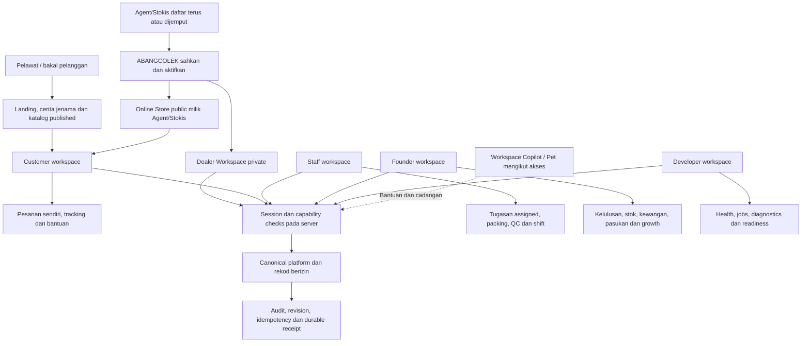
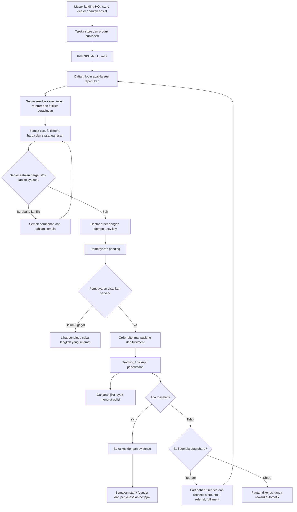
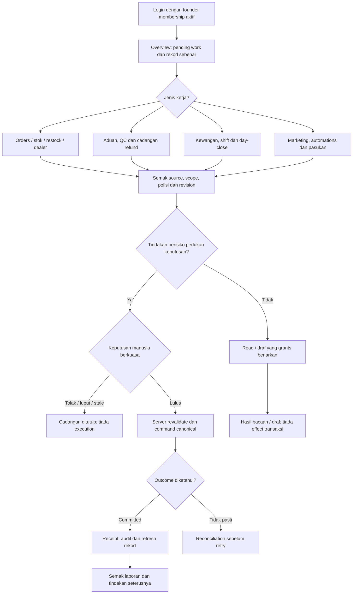
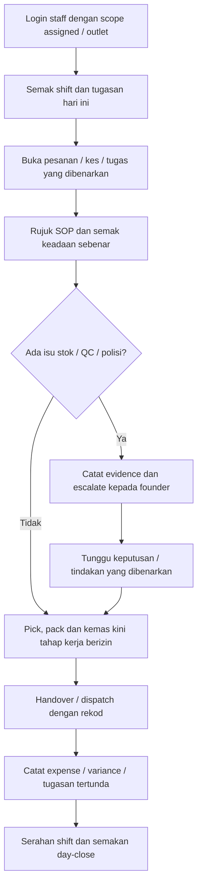
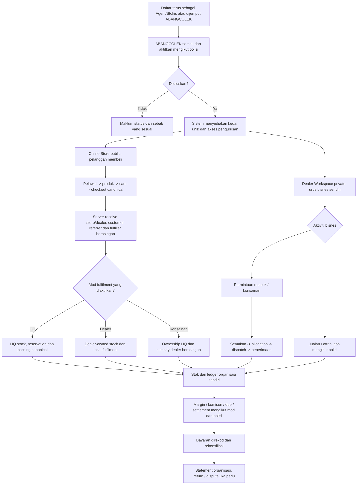
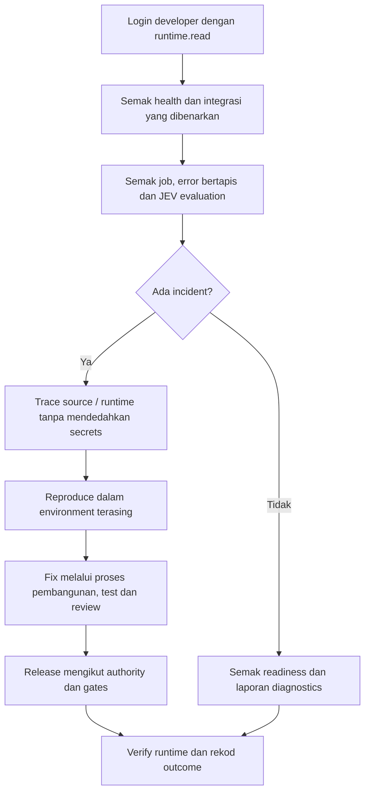
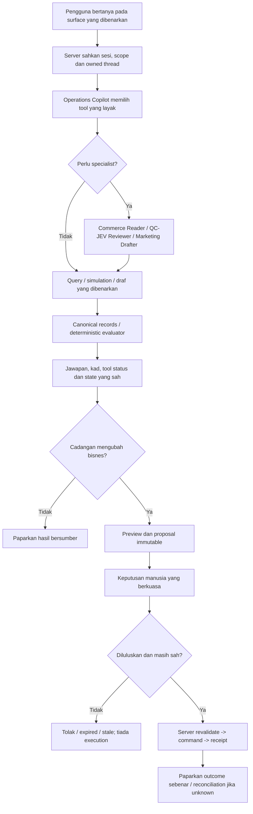
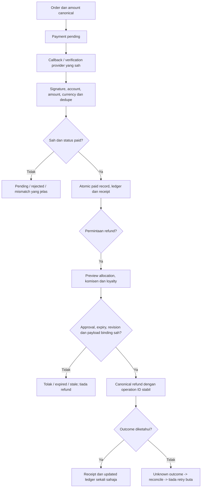
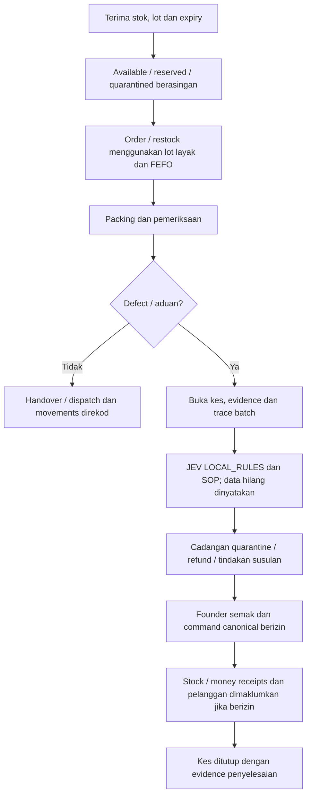
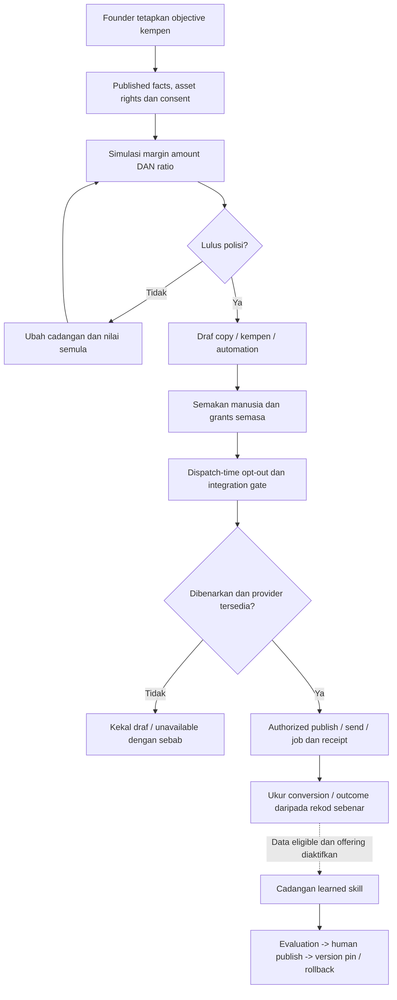

# ABANGCOLEK — atlas workflow pengguna dan operasi

Tarikh: 21 Oktober 2026. **TARGET_DESIGN**, berdasarkan blueprint v2.4 dan taxonomy source semasa. Diagram ini menerangkan aliran yang dikehendaki; ia bukan bukti semua laluan sudah diimplementasikan atau production-ready. Lihat ledger acceptance untuk status sebenar.

Buka [atlas visual dalam browser](workflow-atlas.html) untuk navigasi dan diagram yang boleh dikembangkan.

Empat role source semasa dalam `WorkspaceRole`: **Customer, Staff, Founder, Developer**. **Mandat pengguna 21 Oktober: setiap Agent/Stokis wajib mendapat Dealer Workspace private dan Online Store public sendiri yang disediakan ABANGCOLEK.** Dua surface dealer ini sasaran wajib, belum dibuktikan siap oleh empat role/menu sedia ada. Online Store ialah kedai untuk pelanggan membeli; workspace ialah tempat Agent/Stokis mengurus bisnes. **Copilot ialah lapisan bantuan**, bukan role yang memberi kuasa tambahan. Developer tidak mendapat hak transaksi founder hanya kerana boleh melihat diagnostics.

## 1. Peta ekosistem

## 2. Customer — jumpa produk hingga pembelian dan bantuan

Redirect payment bukan bukti paid. Public tracking menggunakan token sah dan projection minimum; order ID sahaja tidak memberi akses. Produk/harga/ganjaran tidak boleh direka untuk mengisi diagram atau demo.

[Commerce & Growth](commerce-growth.md) ialah kontrak sasaran bagi flow ini: cross-store cart memerlukan pengesahan baharu, anonymous browse hanya membaca published projection dan reorder tidak replay harga/payment lama. Store owner/dealer, customer referrer dan fulfiller boleh berbeza; server memiliki authority dan polisi snapshot. Referral pelanggan satu peringkat dua hala memerlukan kelayakan approved bagi setiap pihak, berasingan daripada wholesale margin, komisen dealer dan points. Share/signup sahaja tidak memberi reward. MadConomy lima tingkat ialah research; top-up, cash withdrawal dan native wajib deferred. Ordering P0 → rewards P1 → retention P2 berada dalam domain phase selepas integriti/runtime prerequisites; diagram tidak menutup acceptance.

## 3. Founder — pantau, putuskan dan rekonsiliasi

Jenis kerja menunjukkan cabang tugas, bukan semua perkara memerlukan butang approval yang sama. Read/draft tidak dianggap transaksi berjaya; setiap command mengikut polisi domain sendiri.

## 4. Staff — kerja assigned, fulfilment dan shift

Staff hanya melakukan command yang capability dan assigned scope benarkan. Diagram bukan pemberian hak untuk meluluskan refund, adjustment atau akses semua outlet.

## 5. Agent/Stokis — workspace sendiri DAN Online Store sendiri

**Maksud ringkas:** ABANGCOLEK memberikan setiap Agent/Stokis sebuah kedai online dan ruang pengurusan. Pendaftaran tidak memerlukan pembelian dahulu. Online Store public mempunyai nama/link kedai unik, katalog, cart dan checkout; Dealer Workspace private mengurus profil kedai, link/QR, order, restock/stok, komisen, settlement dan bantuan mengikut polisi. Contoh laluan sasaran `/kedai/ali-jerux` ialah ilustrasi, bukan URL yang sudah aktif.

Asas `Shop` semasa mempunyai banner Kedai Mini Ejen dan pautan referral. Itu belum membuktikan provisioning kedai setiap dealer, public access, attribution server dan private workspace selesai. Ikut [mandat blueprint §8.1](../ABANGCOLEK-MASTER-GROWTH-BLUEPRINT.md#81-mandat-online-store-setiap-agentstokis--21-oktober-2026) dan prompt Kilo; status acceptance perlu dinilai semula dengan two-dealer browser evidence. Stok dealer, jualan attribution dan konsainan boleh mempunyai polisi berbeza; tidak semua jualan menghasilkan komisen serta-merta. Due/earned tidak sama dengan payout atau bank payment disahkan.

## 6. Developer — pemerhatian dan penyelenggaraan runtime

Developer workspace memberi diagnostics yang dibenarkan; ia tidak secara automatik membenarkan shell, deploy, refund, role escalation atau membaca kewangan founder. Pembaikan/release melalui authority pembangunan berasingan.

## 7. AI Copilot / Pet — tanya, semak dan cadangkan

Ini sasaran penyatuan Pet/workspace. Audit mendapati laluan runtime, shared history, tools/state/card delivery dan callback approval masih mempunyai jurang. Specialist tidak mendapat grants atau budget tambahan; output model bukan payment proof.

## 8. Pembayaran dan refund — jejak wang

Gateway merchant/config dan live callback proof ialah gates luar. Pembetulan pending->paid serta refund receipt-failure recovery wajib dibuktikan sebelum workflow wang dianggap lengkap.

## 9. Inventory, QC dan aduan — trace lot hingga penyelesaian

Quarantine bukan saleable stock. JEV LOCAL_RULES tidak membuktikan native AI vision atau confidence terkalibrasi. Makluman pelanggan memerlukan channel serta consent yang sah.

## 10. Marketing, learning dan automations — pertumbuhan terkawal

Automatic Learning, Memories, Analytics, Channels, WebMCP, Voice dan Attachments mempunyai acceptance/gates berasingan. Diagram tidak mengaktifkan servis itu, tidak menyimpan credential dan tidak memberi kelulusan penghantaran luaran.

## Rujukan dan batas

- Taxonomy: `shared/platform-contracts.ts`, `src/features/platform/routes.ts`.
- Dealer scope: `server/platform/dealers.ts`.
- Target: [master blueprint](../ABANGCOLEK-MASTER-GROWTH-BLUEPRINT.md), [workspaces](workspaces.md), [Copilot features](copilotkit-ten-features.md), [advanced tools](copilot-advanced-tools.md).
- Implementasi dan gates: [prompt Kilo](../prompts/KILO-COMPLETE-PROJECT-20261021.md), [85 requirement](../prompts/KILO-TASK-MATRIX-20261021.md), `reports/implementation/acceptance-status.json`.

Tiada source aplikasi, transaksi, credential, ledger acceptance atau deployment diubah oleh penulisan diagram ini.
