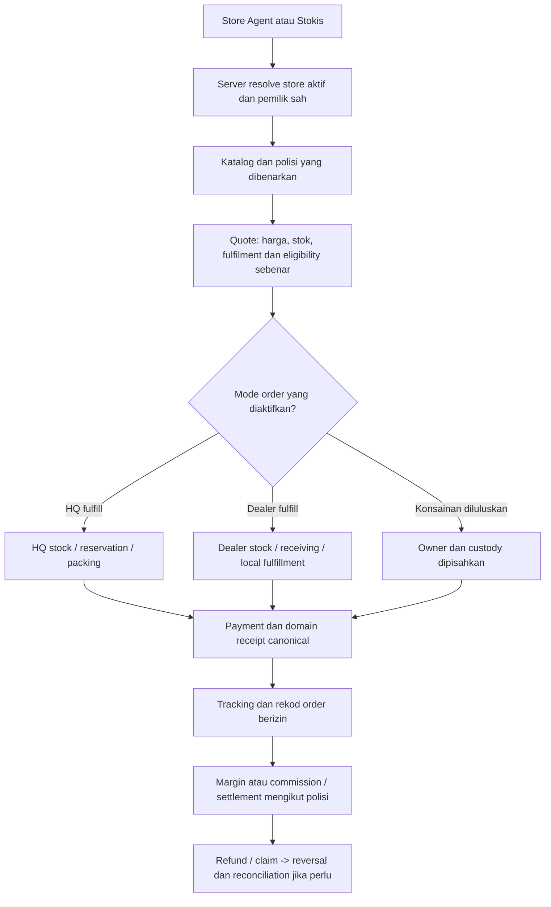

# Research: Online Store Agent/Stokis ABANGCOLEK dan bukti penggunaan sebenar

<!-- COMMERCE-GROWTH-20261021:BEGIN -->
> **Amendment 21 Oktober 2026 — TARGET_DESIGN:** Disposition 21 Oktober: mandat public store setiap Agent/Stokis + private workspace telah dipetakan sebagai TARGET_DESIGN kepada spec dan handover di bawah. Kajian/adoption metrics asal dikekalkan; tiada metric menjadi bukti aplikasi ABANGCOLEK siap atau kelulusan kadar komersial.
>
> Rujukan: [spesifikasi canonical](../design/commerce-growth.md) · [handover lengkap](../prompts/COMMERCE-GROWTH-HANDOVER-20261021.md). Generated acceptance kekal berasaskan ledger dan receipt, bukan nota ini.
<!-- COMMERCE-GROWTH-20261021:END -->

Tarikh semakan: **21 Oktober 2026, Asia/Kuala_Lumpur**.

Status: **RESEARCH_REFERENCE / RECOMMENDATION**. Ini research dan sintesis konsep sedia ada, bukan implementasi, kelulusan terma komersial atau bukti production. Satu fail laporan ini ditambah; tiada aplikasi, blueprint, ledger acceptance, harga, komisen atau deployment diubah dalam task research.

## 1. Keputusan utama

Model yang diminta pengguna mempunyai padanan sebenar dalam industri: **jenama menyediakan storefront peribadi bagi setiap rakan jualan, sementara katalog, order dan kawalan operasi dikendalikan melalui platform bersama**. Natura memberi bukti terkuat tentang penggunaan pada skala besar dan pertumbuhan order pada tempoh tertentu. Oriflame dan Pampered Chef mengesahkan corak storefront peribadi yang disediakan jenama. Ejen2u mengesahkan penggunaan platform HQ–Agent–Stokis di Malaysia. Shopify Collective menunjukkan mekanisme supplier fulfillment yang mempunyai case study berangka, tetapi ia bukan replika tepat sistem kedai ejen yang HQ provision.

**Cadangan untuk ABANGCOLEK:** setiap Agent/Stokis aktif menerima **Online Store public sendiri + Dealer Workspace private**, pada satu platform ABANGCOLEK. Pilihan siapa menyimpan dan menghantar produk ditentukan polisi dealer/order yang sebenar. Jangan menukar semua rakan kepada dropship atau memberi semua transaksi komisen yang sama.

Research menyokong kewujudan dan kebolehgunaan corak ini. Ia belum membuktikan economics ABANGCOLEK: margin Jerux, kos penghantaran, kos claim, repeat purchase dan keuntungan setiap Agent perlu diukur dalam pilot sebenar.

## 2. Brainstorm projek memang sudah wujud

### 2.1 Kajian 2 Oktober: dealer portal dan empat model berasingan

[10_AGENT_STOKIS_BUSINESS_SYSTEM.md](../../reports/research/2026-10-02/10_AGENT_STOKIS_BUSINESS_SYSTEM.md), kandungan bertarikh 2 Oktober dan masuk sejarah Git pada `3801723` bertarikh 3 Oktober, sudah menetapkan:

- Baris 27–33: cadangan buy-resell + stokis berkelayakan, kemudian dropship/konsainan apabila ledger dan fulfillment dapat dijejak; dealer portal sendiri tanpa akses HQ/dealer lain.
- Baris 61–70: perbandingan buy-resell, stokis/hub, dropship/referral HQ dan konsainan.
- Seksyen 5, bermula baris 87: portal B2B `/customer/business/*` dengan business profile, eligible catalogue, restock, stock, receiving, sell-through, statements, claims, marketing kit dan support.
- Baris 168–188: reseller margin, HQ contribution, referral commission dan consignment settlement mesti dipisahkan; tiada benefit kerana registration/recruitment sahaja, atau double reward buy-resell secara default.
- Seksyen 14: rollout dan negative acceptance bagi ownership, pack/quote, pembayaran, receiving serta settlement.

[09_PLATFORM_EXPANSION_ZERO_COST_MASTERPLAN.md](../../reports/research/2026-10-02/09_PLATFORM_EXPANSION_ZERO_COST_MASTERPLAN.md), khususnya seksyen 13 dan 17, juga merangkumi Agent/Stokis sebagai modul teras serta aliran restock hingga statement.

**Apa yang dibuktikan:** portal dealer, pengurusan stok/order dan pemisahan model bukan idea baharu dalam projek. **Apa yang tidak dibuktikan:** semua cadangan asal sudah dibina atau terma komersial contoh sudah diluluskan.

### 2.2 Cadangan UI B2B sudah ada sebelum mandat terkini

[Stitch Agent Restock Portal](../stitch_prompts/abang_colek_agent_restock_portal.md) boleh dijejak melalui Git ke `ad832fa`, 16 Oktober 2026. Ia mendokumentasikan portal borong/restock. Angka tier, diskaun, kuota dan harga dalam mockup ialah ilustrasi; research awal sendiri menyatakan angka commercial belum disahkan. Jangan menjadikan angka Stitch polisi rasmi.

[Customer Commerce MVP](../superpowers/plans/2026-10-17-customer-commerce.md), 17 Oktober, menetapkan katalog -> multi-product cart -> canonical guided checkout dengan validasi harga/stok. Ia ialah asas commerce, bukan bukti storefront setiap dealer provisioned.

### 2.3 Kod Kedai Mini Ejen sudah wujud pada 19 Oktober

Versi commit `e43d258`, 19 Oktober 2026, dalam [commerce.tsx](../../src/features/workspaces/commerce.tsx):

- Baris 14–20 menerima `ref`/`referralCode` dan parameter telefon Agent.
- Baris 54–56 membawa attribution/contact ke checkout.
- Baris 64 memaparkan label “Kedai Mini Ejen”.
- Baris 68 dan 104 menyediakan pautan WhatsApp untuk hubungan dan draf pesanan.

[agent-storefront-referral.test.ts](../../tests/platform/agent-storefront-referral.test.ts) ditambah pada commit yang sama dan mengandungi suite “Agent Storefront & Referral System”. Nama serta kandungan ujian membuktikan konsep/prototaip referral telah dibuat; ujian tidak dijalankan semula dalam research ini.

**Pembetulan kepada sintesis terdahulu:** tidak tepat menggambarkan mini-store Agent sebagai cadangan baharu atau menyimpulkan tiada konsep dealer hanya kerana `WorkspaceRole` mempunyai empat nilai.

**Batas prototaip:** query referral dan banner belum membuktikan store ID/slug tersimpan, auto-provision setiap dealer, anonymous public browsing, private store management, stock-aware dealer fulfillment atau complete payment/refund/commission flow. Input `phone` daripada URL juga bukan bukti pemilik kedai yang disahkan server.

`session-ses_eb0a.md` tidak ditemui pada path root yang disebut atau sejarah tracked path melalui semua refs yang tersedia. Ini batas carian, bukan bukti perbualan asal tidak pernah berlaku.

### 2.4 Hubungan dengan mandat pengguna sekarang

Mandat 21 Oktober menjadikan **Online Store sendiri bagi setiap Agent/Stokis** requirement wajib dan memperjelas public store berbanding workspace private. Ia melengkapkan konsep lama; ia tidak memadam model stok/settlement yang sudah dibezakan dalam brainstorm asal.

## 3. Cara menilai “proven success”

| Label | Maksud | Apa yang tidak boleh disimpulkan |
|---|---|---|
| PRIMARY_OPERATION | Dokumen operator menunjukkan sistem/ciri benar-benar ditawarkan atau diterangkan | Tidak mengesahkan kadar keuntungan setiap ejen |
| COMPANY_REPORTED_RESULT | Annual report atau pengumuman syarikat memberi metrik dalam tempoh tertentu | Tidak semestinya causal proof, independently assured KPI atau prestasi terkini |
| VENDOR_CASE_STUDY | Penyedia teknologi melaporkan hasil pelanggan bernama | Bukan audit bebas atau jaminan hasil jika ditiru |
| REPORTED_INTERVIEW | Media menerbitkan angka yang dikaitkan dengan pihak yang ditemubual | Bukan audited revenue/profit atau pengesahan semua ciri |
| INFERENCE | Cadangan ABANGCOLEK hasil padanan corak dan keadaan projek | Bukan fakta bahawa ABANGCOLEK sudah mencapai hasil tersebut |

Research membezakan **kedai wujud**, **kedai digunakan**, **order/jualan berlaku**, **saluran berkembang**, **HQ untung** dan **Agent untung**. Enam perkara ini memerlukan bukti berbeza. Metrik registered users, GMV dan sales tidak boleh dipanggil keuntungan.

## 4. Kes yang paling relevan

### 4.1 Natura — padanan paling kuat untuk storefront consultant berskala besar

**Bukti:** laporan bersepadu 2024 menyatakan lebih 1.3 juta digital spaces serta menerangkan consultant boleh mempunyai digital store sendiri. Pengumuman Q1 2021 melaporkan order melalui lebih 1.3 juta consultant online stores di Latin America meningkat **80% berbanding Q1 2020**. Ini angka order pada tempoh tertentu, bukan pertumbuhan keuntungan setiap consultant. [Laporan 2024](https://2024ar.naturaeco.report/natura-co-latin-america/omnichannel-journey/), [pengumuman Q1 2021, halaman 1](https://api.mziq.com/mzfilemanager/v2/d/9e61d5ff-4641-4ec3-97a5-3595f938bb75/e9fcd6f3-5ec7-5898-cda8-279e2c08734f?origin=2).

**Padanan:** identiti dan hubungan jualan per consultant, dengan ekosistem jenama bersama.

**Ambil untuk ABANGCOLEK:** kedai personal, pautan produk/kedai untuk dikongsi, aset HQ, rekod attribution dan sokongan latihan.

**Batas:** angka 2021 dipengaruhi konteks pandemik; angka 2024 digital spaces tidak semestinya active sellers. Peningkatan productivity daripada integrasi Natura/Avon tidak boleh dikaitkan kepada storefront sahaja. Tidak ditemui bukti eksperimen causal bahawa membekalkan website sahaja menghasilkan kenaikan order tersebut.

### 4.2 Oriflame — bukti paling jelas jenama membina dan menyelenggara kedai rakan jualan

**Bukti:** terma Personal Beauty Store menyatakan Oriflame mengendalikan dan menyelenggara PBS pages serta membekalkan pautan; pelanggan membeli melalui website syarikat. Dokumen program rasmi turut mentakrifkan kedai peribadi sebagai direka dan dihoskan Oriflame pada pasaran terpilih. [Terma PBS UK](https://uk.oriflame.com/terms-and-conditions/online-selling), [dokumen program rasmi](https://media-cdn.oriflame.com/static-media-web/5e5a0dcb-c83f-4211-aa63-e7e06ec2234a?mimeType=application%2Fpdf&name=SUCCESS+PLAN+PDF+2).

**Padanan:** sangat rapat dengan “ABANGCOLEK menyediakan kedai untuk Agent”.

**Ambil:** template jenama bersama, pautan milik rakan, catalogue updates terpusat, attribution dan status eligibility yang jelas.

**Batas komersial:** laporan syarikat untuk 2024 merekod jualan turun **20% dalam Euro kepada €604.2 juta**. Jadi ia bukti operasi corak storefront, bukan contoh bahawa corak ini menjamin pertumbuhan syarikat. Polisi/compensation plan mereka tidak diangkat sebagai polisi ABANGCOLEK. [Laporan tahun 2024, diterbitkan 18 Mac 2025](https://corporate.oriflame.com/news/year-end-report-1-january-31-december-2022/). URL lama halaman itu menyebut 2022 tetapi tajuk dan kandungan yang dibaca ialah laporan 2024.

### 4.3 Pampered Chef — kedai consultant dan penghantaran oleh warehouse

**Bukti:** halaman rasmi menerangkan personal website bagi consultant dan pesanan pelanggan yang dihantar terus dari warehouse; ia juga menyediakan bahan marketing. Halaman tersebut menyenaraikan caj website selepas tempoh awal, maka contoh ini tidak membuktikan model tanpa kos. [Halaman consultant rasmi](https://www.pamperedchef.com/be-a-consultant).

**Padanan:** storefront personal + Agent fokus jualan + HQ fulfillment.

**Ambil:** store, social selling, approved marketing kit, order tracking dan sokongan consultant sebagai satu pengalaman.

**Batas:** ini bukti model ditawarkan, bukan angka uplift yang diasingkan kepada kedai consultant. Income disclosure dan FAQ berbeza mengikut market; research tidak memindahkan kadar komisen, yuran atau dakwaan pendapatan itu kepada ABANGCOLEK.

### 4.4 Sweet Water Decor / Shopify Collective — case study order routing yang berangka

**Bukti vendor:** Shopify melaporkan Collective menyumbang **9% daripada total annual Shopify sales** Sweet Water Decor melalui aktiviti supplier serta retailer; **126 partnerships** terdiri daripada 91 retailers dan 35 suppliers; jualan pertama berlaku sembilan hari selepas pemasangan. [Case study Shopify](https://www.shopify.com/case-studies/sweet-water-decor).

**Padanan separa:** retailer menjual melalui kedainya, supplier menerima order dan fulfill. Dokumentasi rasmi menerangkan routing order serta tracking supplier ke retailer. [Cara operasi Collective](https://help.shopify.com/en/manual/online-sales-channels/shopify-collective/retailers).

**Ambil:** stock/price sync, seller berbanding fulfiller berasingan, order routing dan status shipment.

**Batas:** retailer biasanya mempunyai store sendiri yang telah wujud; Collective tidak membuktikan HQ auto-provision kedai untuk setiap Agent. Angka 9% bukan keseluruhan revenue syarikat, keuntungan bersih atau causal incremental growth. Ini case study vendor, bukan audit bebas.

**Kesesuaian produk:** senarai kelayakan rasmi yang dibaca tidak menyenaraikan Malaysia/MYR dan memerlukan active Shopify plan serta Shopify Payments. Oleh itu cadangan ialah mempelajari coraknya dalam platform ABANGCOLEK sedia ada, bukan terus menggunakan Collective untuk deployment Malaysia. [Requirements dan negara/currency](https://help.shopify.com/en/manual/online-sales-channels/shopify-collective/retailers/requirements-and-considerations).

### 4.5 Ejen2u / EjenGO — bukti penggunaan HQ–Agent–Stokis di Malaysia

**Bukti:** halaman operator menyenaraikan model Trading/Centralized, order/inventory, commission, reseller management dan reporting. Interview Majoriti pada **25 April 2025** melaporkan, sejak 2019, transaksi melebihi **RM900 juta**, melibatkan 600 pengasas jenama dan lebih 400,000 ejen berdaftar. [Produk rasmi EjenGO](https://ejen2u.com/en/ejengo-2/), [interview Majoriti](https://majoriti.com.my/berita/2025/04/25/mahu-terus-bantu-pks-demi-realisasi-visi-039satu-rumah-satu-usahawan039-ejen2u-kini-hampiri-nilai-transaksi-rm1-bilion).

**Padanan:** pengurusan dealer/HQ dalam konteks Malaysia, termasuk dua mode bekalan dan latihan.

**Ambil:** dealer statement, restock, HQ dashboard, payment/reconciliation, assets dan onboarding yang membantu penjual aktif.

**Batas:** angka ialah interview-reported cumulative transaction value, bukan audited profit atau jualan tahunan setiap jenama. Registered tidak sama dengan active. Halaman vendor menunjukkan counter dinamik yang kadangkala 0 dalam fetch; report ini tidak menganggap nilai 0 itu data adoption sebenar. Tiada bukti kukuh ditemui bahawa setiap ejen dalam angka tersebut menerima storefront public individu dengan semantics yang sama seperti mandat ABANGCOLEK. Bukti EjenGO tidak cukup untuk claim model storefront individu kita sudah proven secara keseluruhan di Malaysia.

## 5. Perbandingan: apa sebenarnya dibuktikan?

| Contoh | Jenama sediakan kedai personal | Rekod prestasi yang ditemui | Kegunaan kepada projek |
|---|---|---|---|
| Natura | Ya, consultant digital stores diterangkan | Adoption dan kenaikan order pada tempoh tertentu, company-reported | Benchmark utama public dealer storefront dan activation |
| Oriflame | Ya, obligations penyediaan/maintenance jelas | Operasi jelas; financial results turut menunjukkan decline | Benchmark struktur, bukan janji growth |
| Pampered Chef | Personal website dan warehouse fulfillment diterangkan | Tiada uplift storefront khusus disahkan dalam semakan | Benchmark Agent menjual, HQ fulfill |
| Sweet Water Decor | Retailer store sedia ada, bukan auto-provision HQ | Metrik channel daripada vendor case study | Benchmark order/tracking/stock routing |
| Ejen2u | Personalization HQ ada; per-ejen public store universal belum disahkan | Nilai transaksi kumulatif dan ejen berdaftar, dilaporkan melalui interview | Benchmark operasi dealer Malaysia |

Corak teknologi storefront tidak menetapkan compensation plan. ABANGCOLEK kekal mengikut single-level dan canonical money rules blueprint. Reward enrollment, upline berlapis atau target pembelian contoh sumber tidak ditambah kerana syarikat rujukan menggunakannya.

## 6. Cadangan model yang menyambung brainstorm asal

### 6.1 Satu platform, dua surface untuk setiap Agent/Stokis

**Public Online Store** memberi nama/identiti kedai yang diluluskan, catalogue published, cart, checkout, approved contact dan tracking minimum berizin. **Dealer Workspace private** memberi kawalan profil kedai, pautan/QR, pesanan yang perlu untuk kerja dealer, restock/stok, statement, komisen/settlement, bantuan dan approved marketing kit.

Kedai individu tidak memerlukan deploy aplikasi, database dan langganan berasingan bagi setiap Agent. Cadangan teknikal ialah satu aplikasi ABANGCOLEK dengan store ID stabil serta mapping pemilik/organisasi pada server. Ini keputusan reka bentuk untuk disahkan dengan source, bukan dakwaan tentang backend syarikat rujukan. Caj payment, hosting, storage, delivery atau support tetap perlu dikira daripada penggunaan sebenar.

### 6.2 Storefront sama konsepnya; fulfillment berbeza

| Mode dealer yang diaktifkan | Stock owner / fulfiller | Sumber hasil dealer | Syarat yang perlu dipin |
|---|---|---|---|
| Agent tanpa stok / dropship yang diluluskan | HQ/approved fulfiller; Agent menjual | Komisen atas eligible order | Attribution, payment, fulfillment, return window/reversal |
| Reseller atau stokis dengan stok dibeli | Dealer mengikut ownership transfer dan receiving | Margin jualan selepas landed cost | Wholesale terms, local available stock, delivery/pickup dan claim |
| Konsainan yang diluluskan | Ownership HQ berasingan daripada custody dealer | Settlement/margin/fee yang dipersetujui | Owner, custodian, location, batch, sell-through dan reconciliation |

Semua mode menerima kedai sendiri mengikut mandat pengguna. Tidak semua mode mesti diaktifkan serentak. Prioriti buy-resell/stokis daripada research asal kekal rujukan rollout sehingga polisi operasi baharu diluluskan; kewujudan website tidak secara automatik mengaktifkan dropship atau konsainan.

**Rule utama:** satu transaksi tidak menerima margin buy-resell dan komisen dropship secara default. Jika ada benefit tambahan, ia mesti explicit dalam polisi yang approved dan lulus pengiraan contribution.

### 6.3 Order mesti tahu siapa menjual dan siapa fulfill

Fulfillment policy, seller/merchant identity dan payment recipient perlu dinyatakan dengan tepat dalam checkout/order. Diagram tidak menetapkan siapa merchant of record atau memindahkan dana secara automatik tanpa keputusan bisnes dan setup payment sebenar.

## 7. Apa yang patut diambil dan apa yang patut ditangguhkan

### Wajib pada store MVP

1. Provision store unik dan private access selepas dealer activation yang sah; dealer sedia ada boleh dijemput tanpa repeat application. Duplicate activation tidak menghasilkan store kedua.
2. Public product browsing, link/share/QR dan profile fields yang diluluskan.
3. Master catalogue, harga dan promotions berversi; dealer tidak menyunting fakta produk atau harga di luar polisi.
4. Server-bound `storeId`/dealer attribution, cart/store conflict handling dan per-order snapshot. Query `ref` lama hanya compatibility input yang divalidasi, bukan authority.
5. Availability mengikut sumber fulfillment sebenar; tidak menunjukkan stok HQ seolah-olah stok Agent tempatan.
6. Canonical checkout, payment pending/verified, tracking, refund dan complaint path.
7. Ledger yang membezakan sales, earned benefit, reversals, due dan paid, dengan statement dealer yang boleh direconcile.
8. Scope: semua pelawat boleh melayari public store; hanya pemilik/pihak berizin mengakses pengurusan serta private orders/statement.
9. Suspend/revoke menghentikan jualan baharu mengikut polisi tanpa menghapus rekod/receipt lama.
10. Approved content kit, onboarding dan latihan ringkas; website sahaja tidak menghasilkan traffic atau kemahiran jualan.

### Selepas transaksi dan penggunaan pilot terbukti

- Nearest-stockist routing memerlukan lokasi/service coverage, stock freshness dan pilihan pelanggan yang sah.
- AI membantu product facts, SOP, drafts dan explanation daripada data berizin; AI bukan prasyarat bagi order, money atau stock correctness.
- Auto-restock memerlukan demand, lead time dan expiry sah; mulakan proposal dan exception queue.
- Custom domains, site builder bebas, multi-seller cart dan automated payout bukan keperluan awal untuk memenuhi kedai personal. Tambah hanya apabila ada economics dan operational need.

## 8. Pilot untuk membuktikan kesesuaian ABANGCOLEK

Cadangan eksperimen: mulakan cohort kecil yang dapat disokong operasi, contohnya **10–20 Agent/Stokis selama 4–6 minggu**, dengan mode, quota dan terma diluluskan. Angka ini cadangan skop pilot, bukan angka proven atau syarat commercial. Semua peserta pilot menerima store; rollout seluruh network dibuat berperingkat selepas gates lulus, tanpa menggugurkan mandat store untuk setiap dealer aktif.

Rekod baseline workflow sedia ada dan penggunaan store baharu pada cohort/window yang jelas. Jika saiz membenarkan, gunakan staggered rollout untuk membandingkan masa/segmen; jangan menyebut perbezaan cohort kecil sebagai causal proof.

| Ukuran | Definisi / denominator |
|---|---|
| Provisioning correctness | Approved dealers dengan tepat satu store yang betul; duplicate/failed activations dilapor |
| Activation | Dealer yang mendapat paid order pertama / dealer dengan store aktif dalam cohort dan window yang sama |
| Checkout conversion | Eligible completed paid orders / eligible store checkout starts; asingkan test traffic dan duplicate |
| Attributed sales | Net paid sales yang store/dealer bindingnya dapat direconcile; bukan jumlah klik |
| Repeat purchase | Repeat buyers / eligible buyers bagi cohort dan tempoh yang ditetapkan |
| HQ contribution | Net sales less actual variable product/fulfillment/payment/benefit/claim costs; missing costs kekal unknown |
| Dealer economics | Margin atau commission yang layak, kos relevan dan payout sebenar dipisahkan |
| Operations | Packing/dispatch/receipt lead time, stock variance, refund/claim rate dan unresolved payment outcomes |
| Support load | Cases dan masa bantuan bagi setiap active dealer / fulfilled order |

Hard gates teknikal: tiada unauthorized private access dalam ujian; no duplicate money/stock effects; server attribution tepat; payment/reversal/stock ledgers reconcile; unsupported/unknown outcome tidak dipaparkan sebagai success. Sasaran commercial seperti minimum margin, activation atau repeat purchase mesti datang daripada baseline/kos dan keputusan founder, bukan disalin daripada benchmark luar.

## 9. Kesimpulan dan keputusan yang boleh digunakan

1. **Konsep asal projek sudah ada.** Gunakan semula dealer portal, stock ledger, attribution/cart dan dokumen operasi; jangan membina sistem baharu yang membuang invariants tersebut.
2. **Kedai per Agent ialah corak yang mempunyai bukti penggunaan nyata.** Natura paling kuat untuk skala/adoption dan order growth; Oriflame paling jelas tentang provisioned brand store; Pampered Chef relevan untuk HQ fulfillment.
3. **Satu store tidak bermaksud satu model fulfillment.** Ikut pemisahan buy-resell/stokis/dropship/konsainan dalam brainstorm asal.
4. **Website bukan jaminan profit atau Agent aktif.** Aktivasi, latihan, acquisition, produk, contribution dan service perlu diukur.
5. **Cadangan bukan membeli platform rujukan.** Corak boleh diadaptasi pada React/Vite + Bun + persistence ABANGCOLEK sedia ada; framework/hosting tidak diubah oleh research ini.

Mandat produk kekal: **ABANGCOLEK menyediakan Online Store dan Dealer Workspace untuk setiap Agent/Stokis aktif.** Research ini menyokong pelaksanaan berfasa dengan data dan bukti; ia tidak menandakan implementasi tersebut sudah lengkap.

## 10. Sumber dan batas semakan

Sumber utama dihubungkan berhampiran claim. Halaman rasmi Natura/Oriflame/Pampered Chef/Shopify/EjenGO dibaca; Q1 2021 Natura PDF dibaca dan dipadankan dengan tarikh laporan. Majoriti ialah interview pihak ketiga yang menyampaikan angka pengasas, dilabel demikian. Odoo consignment/FEFO direct fetch timeout pada semakan ini, maka ia tidak dijadikan bukti baharu yang disahkan; ia kekal rujukan historical research 2 Oktober. Avon policy PDF direct fetch 403, maka ia tidak dipakai sebagai bukti utama kesimpulan.

Tiada founder/dealer interview baharu, audited ABANGCOLEK cost data, live order, provider transaction, browser shopping test syarikat rujukan, migration, signup, bayaran, pemasangan SaaS, commit, push atau deploy dilakukan. Search-index snippets, angka sample mockup dan current edits bertarikh 21 Oktober tidak digunakan sebagai bukti brainstorm lama.
