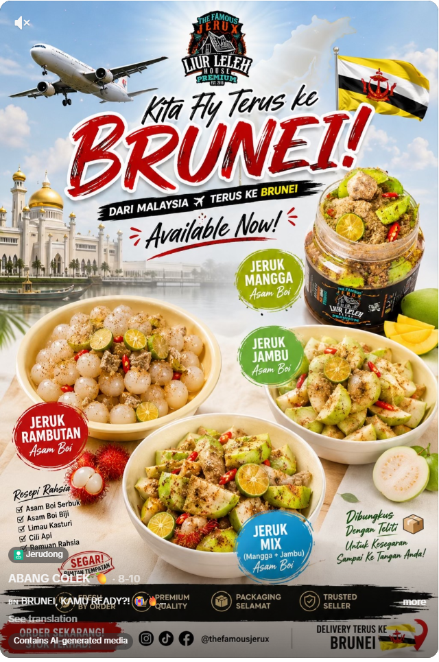
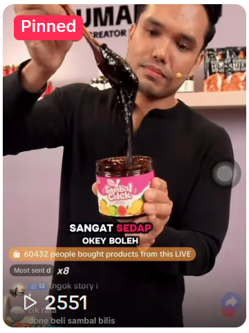
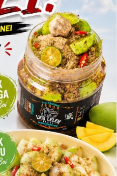
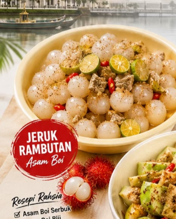
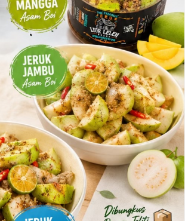
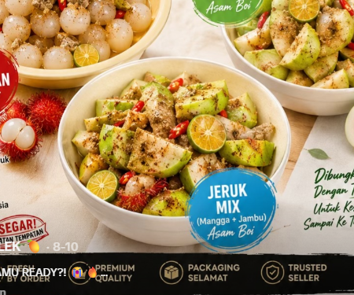

# Research ABANG COLEK: Founder, Media Sosial dan Produk

**Tarikh semakan:** 24 Oktober 2026  
**Skop:** Sumber awam yang boleh dibaca pada profil TikTok, Instagram, Threads, Linktree dan Facebook berkaitan ABANG COLEK serta founder/brand yang dipautkan.

## Dapatan utama

ABANG COLEK menggunakan akaun TikTok **@styloairpool** sebagai akaun berjenama “ABANG COLEK 🥭”. Bio akaun itu menyebut “Founder | Motivator” dan memaut ke Linktree `THEFRUITJUNKIE`; paparan semasa yang disemak menunjukkan kira-kira **76.6K followers** dan **827.4K likes**. [1]

Handle founder yang paling konsisten dikenal pasti ialah **Instagram @airpoolstylo**. Bio Instagram menyebut **“FOUNDER OF LIURLELEH HOUSE®️”** dan memaut/menandakan `@liurlelehhousehq` serta `@sambaginghq`. Paparan semasa yang disemak menunjukkan kira-kira **22.8K followers**. Nama peribadi founder tidak dinyatakan secara jelas pada sumber awam yang dapat dibaca, jadi laporan ini menggunakan handle dan identiti brand sahaja. [2]

Linktree rasmi yang dipaparkan pada profil TikTok ialah **THEFRUITJUNKIE**. Halaman itu menyenaraikan pautan Instagram, TikTok dan WhatsApp, serta pilihan **“Nak Order 🥭 Dan Daftar Agent”**. [3]

## Senarai social media founder dan ABANG COLEK

### Akaun utama founder/ABANG COLEK

- **TikTok — ABANG COLEK:** [@styloairpool](https://www.tiktok.com/@styloairpool?lang=en). Bio memaparkan “Founder | Motivator” dan pautan order melalui Linktree. Ini ialah akaun utama yang paling jelas menggabungkan identiti founder dengan brand ABANG COLEK. [1]
- **Instagram — founder:** [@airpoolstylo](https://www.instagram.com/airpoolstylo/). Bio memaparkan “FOUNDER OF LIURLELEH HOUSE®️” serta menandakan akaun `@liurlelehhousehq` dan `@sambaginghq`. [2]
- **Threads — founder:** [@airpoolstylo](https://www.threads.com/@airpoolstylo). Carian awam memadankan handle yang sama dengan nama profil “FOUNDER OF LIURLELEH HOUSE®️”. [16]

### Saluran rasmi/order yang dipautkan

- **Linktree/order hub:** [THEFRUITJUNKIE](https://linktr.ee/THEFRUITJUNKIE). Halaman ini memautkan Instagram, TikTok dan WhatsApp, serta pilihan order dan daftar agent. [3]
- **WhatsApp:** tersedia melalui butang WhatsApp di Linktree rasmi. Nombor telefon tidak dipaparkan dalam kandungan teks yang boleh dibaca, jadi saya tidak mereka atau meneka nombor tersebut. [3]

### Akaun brand berkaitan founder

Akaun berikut dikaitkan secara terbuka melalui bio Instagram founder, tetapi **bukan akaun founder peribadi** dan tidak patut dilabel sebagai akaun ABANG COLEK utama tanpa konteks:

- **Instagram — Liur Leleh House/The Famous Jerux:** [@liurlelehhousehq](https://www.instagram.com/liurlelehhousehq/?hl=en). [2] [17]
- **Instagram — Sambaging HQ:** [@sambaginghq](https://www.instagram.com/sambaginghq/). [2] [18]
- **Facebook — Liur Leleh House:** [Liur Leleh House](https://www.facebook.com/liurlelehhouse/). [19]
- **Facebook — Sambaging HQ:** [Sambaging HQ](https://www.facebook.com/sambagingHQ/). [20]

**Kesimpulan akaun:** setakat sumber awam yang dapat disahkan, terdapat **3 akaun utama founder/ABANG COLEK**, **1 hub order**, **1 saluran WhatsApp melalui hub**, dan **4 akaun brand berkaitan founder**. Saya tidak menemui halaman Facebook, YouTube atau X/Twitter rasmi ABANG COLEK yang boleh disahkan dengan handle dan bio yang konsisten; halaman/siaran pihak ketiga tidak dikira sebagai akaun rasmi.

## Galeri visual produk rasmi

Visual di bawah ditangkap terus daripada halaman TikTok rasmi **@styloairpool**. Visual pertama datang daripada post order jeruk rasmi; visual kedua ialah thumbnail video yang dipinkan pada profil rasmi dan menunjukkan produk Sambal Colek. [1] [7]

Nota: screenshot mengekalkan elemen UI TikTok dan label platform yang kelihatan pada halaman asal. Ia ialah bukti visual sumber sosial, bukan gambar katalog studio yang diedit.

### Imej produk jeruk secara berasingan

Dalam post asal, hanya **Jeruk Mangga Asam Boi** jelas ditunjukkan dalam balang. Tiga visual lain ialah hidangan dalam mangkuk daripada poster rasmi yang sama; tiada foto balang rasmi yang berasingan dapat disahkan daripada sumber awam yang dibaca.

## Produk ABANG COLEK paling latest yang dapat disahkan

Berdasarkan semakan terkini, produk berbungkus yang paling jelas masih dijual ialah **Sambal Colek ABANG COLEK versi packaging baharu**. Sumber Threads menyebut “new packaging, new look” dan produk itu sudah masuk ke **beg kuning/TikTok Shop**. [5] [6]

Untuk jualan jeruk, post order ABANG COLEK yang dapat dibaca secara penuh menyenaraikan empat pilihan: **Jeruk Mangga Asam Boi, Jeruk Rambutan Asam Boi, Jeruk Jambu Asam Boi dan Jeruk Mix**. Post itu menyatakan order dibuka secara terhad melalui DM/PM untuk penghantaran ke Brunei. [7]

### Senarai latest confirmed

1. **Sambal Colek ABANG COLEK — packaging baharu; tersedia melalui beg kuning/TikTok Shop.**
2. **Jeruk Mangga Asam Boi — disenaraikan dalam post order jeruk terbaru yang disemak.**
3. **Jeruk Rambutan Asam Boi — disenaraikan dalam post order jeruk terbaru yang disemak.**
4. **Jeruk Jambu Asam Boi — disenaraikan dalam post order jeruk terbaru yang disemak.**
5. **Jeruk Mix — disenaraikan sebagai pilihan campuran dalam post order yang sama.**

**Status keseluruhan:** kelima-lima item di atas ialah produk paling selamat untuk dimasukkan ke bahagian “Latest Products”. Harga, saiz, stok harian dan kawasan penghantaran semasa masih tidak dipaparkan secara konsisten pada sumber awam yang boleh dibaca.

## Menu produk menyeluruh daripada social media

Bahagian ini menggabungkan semua nama produk/menu yang dapat ditemui dalam kandungan ABANG COLEK dan akaun brand yang dipautkan oleh founder. Label **latest confirmed** bermaksud ada bukti order atau jualan yang lebih baru; **event/seasonal** bermaksud muncul untuk festival, booth atau penghantaran terhad; **variasi content** bermaksud buah atau penyediaan pernah dipaparkan tetapi SKU dan stok semasa tidak disahkan; **brand berkaitan** bermaksud produk di bawah Liur Leleh House atau Sambaging HQ, bukan semestinya SKU ABANG COLEK.

### A. Menu utama ABANG COLEK — latest confirmed

- **Sambal Colek ABANG COLEK** — produk berbungkus, rasa pedas-manis, pekat dan likat; diumumkan dengan packaging baharu dan order melalui beg kuning/TikTok Shop. [4] [5] [6]
- **Jeruk Mangga Asam Boi** — pilihan jeruk yang disenaraikan dalam post order penghantaran. [7]
- **Jeruk Rambutan Asam Boi** — pilihan jeruk yang disenaraikan dalam post order penghantaran. [7]
- **Jeruk Jambu Asam Boi** — pilihan jeruk yang disenaraikan dalam post order penghantaran. [7]
- **Jeruk Mix** — pilihan campuran dalam post order jeruk yang sama. [7]

### B. Menu buah colek/jeruk yang pernah dipaparkan — variasi content

- **Kedondong colek/jeruk** dengan asam boi, cili dan limau kasturi. [8]
- **Baby nanas colek/jeruk** dengan asam boi, limau kasturi dan cili. [9]
- **Mangga colek/jeruk** dengan rasa masam-manis-pedas. [10]
- **Rambutan colek/jeruk** dengan limau kasturi dan cili. [11]
- **Jambu** sebagai buah colek/jeruk; post terbaru turut menyebut jeruk mangga dan jambu di booth. [21]
- **Rojak buah/Colek Buah** dengan sos colek ABANG COLEK. Sumber event luar menyebut “Rojak Buah” dan “sos” ABANG COLEK; ia disimpan sebagai menu event/booth, bukan SKU berbungkus. [22]

### C. Menu event atau seasonal

- **Sour Plum Slurpee** — disebut dalam promosi ABANG COLEK untuk event DEPOCO di Brunei. [23]
- **Green Sour** — turut disebut dalam promosi event yang sama. [23]
- **Jeruk Leleh/The Famous Jerux** — nama kempen/menu yang digunakan untuk stok jeruk dan booth, termasuk pilihan jambu, rambutan dan baby fruit. [24]
- **Jeruk Mix Fresh by Order** — disebut dalam promosi penghantaran/event ke Singapura; statusnya bergantung pada lokasi dan slot order. [25]

### D. Menu brand berkaitan founder — bukan SKU ABANG COLEK utama

- **Sambaging Cili Usik Usik / Sambal Daging Cili Usik Usik** — produk daging premium ready-to-eat/instant, dikaitkan dengan `@sambaginghq`. Sumber lama menyebut penyediaan kira-kira lima minit dan saiz 300 gram/packbox, tetapi harga/stok semasa perlu disemak pada saluran jualan. [12] [13] [26]
- **Jeruk mangga**, **jeruk mangga asam boi**, **kundang muda**, **mangga muda**, **jeruk masam**, **jeruk asam boi**, **salak madu**, **pelam salak** dan **jeruk pelam** — nama variasi yang muncul dalam kandungan Liur Leleh House/The Famous Jerux. Kebanyakannya ialah katalog lama atau variasi brand, bukan pengesahan stok ABANG COLEK hari ini. [14] [15]
- **Sour Plum Slurpee**, **Corndog** dan **Boba** — pernah muncul dalam kandungan/hashtag cabang Liur Leleh House; jangan masukkan sebagai menu ABANG COLEK harian tanpa pengesahan stok. [15]

### Kesimpulan menu

Jika yang diperlukan ialah **menu jualan ABANG COLEK yang paling selamat untuk dipaparkan sekarang**, gunakan lima item dalam seksyen A. Jika yang diperlukan ialah **seluruh menu yang pernah digunakan oleh brand dan founder**, gunakan item A hingga D dengan label status masing-masing. Social media tidak memaparkan satu menu rasmi yang stabil dengan harga, saiz, add-on dan stok harian; sebab itu senarai ini membezakan produk yang disahkan daripada variasi content, event dan katalog lama.

## Produk/variasi lain yang pernah dipaparkan

### 1. Sambal Colek ABANG COLEK

Ini ialah produk yang paling jelas disahkan sebagai produk berbungkus yang dijual. Video yang dipinkan pada TikTok menyebut **“Sambal Colek”** dengan ciri rasa **pedas, manis, pekat dan likat**, serta menyatakan pelanggan boleh membuat pesanan melalui **beg kuning/TikTok Shop**. [4]

Satu lagi video TikTok menyebut produk yang sama sebagai **“SAMBAL COLEK ABANG COLEK”** dan mengumumkan kemasukan ke beg kuning. Sumber Threads founder turut menyebut produk ini kembali dengan **new packaging/new look**. [5] [6]

### 2. Jeruk Mangga Asam Boi

Produk jeruk mangga dengan asam boi disebut secara terus dalam promosi penghantaran ke Brunei. [7]

### 3. Jeruk Rambutan Asam Boi

Varian jeruk rambutan asam boi turut disenaraikan dalam promosi penghantaran ke Brunei. [7]

### 4. Jeruk Jambu Asam Boi

Varian jeruk jambu asam boi turut disenaraikan dalam promosi penghantaran ke Brunei. [7]

### 5. Jeruk/Kolek Kedondong

Kandungan TikTok rasmi menunjukkan **kedondong** yang digaul dengan asam boi, cili dan limau kasturi. Kapsyen itu mengesahkan produk/penyediaan buah berasaskan kedondong, tetapi sumber awam yang dibaca tidak memberikan nama SKU, saiz balang atau harga khusus. [8]

### 6. Buah colek nanas

TikTok rasmi memaparkan **baby nanas** dengan asam boi, limau kasturi dan cili. Ini mengesahkan nanas sebagai salah satu pilihan buah colek/jeruk yang dipromosikan. [9]

### 7. Buah colek mangga

TikTok rasmi turut memaparkan mangga sebagai pilihan buah yang dimakan dengan gaya colek. Sumber tersebut tidak mendedahkan nama SKU atau harga. [10]

### 8. Buah colek rambutan

TikTok rasmi memaparkan rambutan yang dipadankan dengan limau kasturi dan cili. Sumber yang dibaca menunjukkan ia sebagai variasi kandungan/produk buah colek, tetapi tidak memberikan SKU berasingan. [11]

## Produk berkaitan yang dipautkan kepada founder, tetapi bukan patut dilabel sebagai SKU ABANG COLEK tanpa pengesahan lanjut

### Sambaging Cili Usik Usik / Sambal Daging Cili Usik Usik

`@sambaginghq` ialah brand berasingan yang dipautkan pada bio Instagram founder. Sumber Facebook dan Instagram menyebut **“Sambaging Cili Usik Usik”**, **“Sambal Daging Cili Usik Usik”**, resipi daging/sambal gaya kampung, serta format **ready-to-eat** yang boleh direndam kira-kira lima minit dalam air panas. Ini ialah produk yang boleh dikaitkan dengan ekosistem founder, tetapi bukti awam tidak menunjukkan bahawa ia dijual di bawah SKU ABANG COLEK. [2] [12] [13]

### Produk Liur Leleh House/The Famous Jerux yang muncul dalam sumber lama atau akaun cabang

Sumber sosial berkaitan Liur Leleh House menyebut atau menggunakan hashtag untuk beberapa item berikut: **jeruk mangga asam boi, jeruk mangga, kundang muda, mangga muda, jeruk masam, jeruk asam boi, salak madu, pelam salak, jeruk pelam, sour plum slurpee, corndog dan boba**. Senarai ini patut dianggap sebagai **katalog brand/cabang dan sejarah promosi**, bukan pengesahan bahawa semua item masih dijual sekarang atau semuanya ialah SKU ABANG COLEK. [14] [15]

## Senarai ringkas latest untuk dimasukkan ke katalog produk

Jika katalog itu hendak mewakili **produk ABANG COLEK yang paling latest**, gunakan lima item berikut sebagai senarai utama:

1. **Sambal Colek ABANG COLEK — packaging baharu**
2. **Jeruk Mangga Asam Boi**
3. **Jeruk Rambutan Asam Boi**
4. **Jeruk Jambu Asam Boi**
5. **Jeruk Mix**

Jangan letakkan **Kedondong, Nanas, Mangga atau Rambutan buah colek** sebagai produk latest berasingan buat masa ini. Ia memang pernah dipaparkan pada kandungan TikTok, tetapi sumber yang boleh dibaca tidak mengesahkan SKU, harga atau stok semasa untuk setiap buah itu.

Jika katalog itu hendak mewakili **seluruh ekosistem perniagaan founder**, tambahkan sebagai kategori berasingan:

- **Sambaging Cili Usik Usik / Sambal Daging Cili Usik Usik**
- Produk lama/cabang Liur Leleh House seperti jeruk mangga, kundang muda, salak/pelam, sour plum slurpee, corndog dan boba—dengan status “perlu sahkan stok semasa”.

## Batasan penting

Sumber sosial tidak memaparkan satu katalog SKU rasmi lengkap dengan kod produk, saiz, harga, stok dan status aktif. Sebahagian kandungan ialah promosi bermusim, jualan jelajah/event atau video menu lama. Oleh itu, senarai di atas ialah **senarai produk yang dapat dikenal pasti daripada bukti awam**, bukan jaminan bahawa setiap variasi masih tersedia pada 24 Oktober 2026. Untuk pengesahan operasi, setiap item perlu dipadankan dengan katalog TikTok Shop/WhatsApp semasa.

## References

[1]: https://www.tiktok.com/@styloairpool?lang=en "ABANG COLEK di TikTok"
[2]: https://www.instagram.com/airpoolstylo/ "Founder of Liurleleh House di Instagram"
[3]: https://linktr.ee/THEFRUITJUNKIE "Linktree ABANG COLEK"
[4]: https://www.tiktok.com/@styloairpool/video/7683386311431982343 "Video Sambal Colek ABANG COLEK"
[5]: https://www.tiktok.com/@styloairpool/video/7683047307016834322 "Video Sambal Colek masuk beg kuning"
[6]: https://www.threads.com/@airpoolstylo/post/DdBNOMylGsO/abang-colek-is-backkk-kali-ni-bukan-biasa-biasa-weh-new-packaging-new-look-same/ "Threads founder tentang kembalinya Sambal Colek"
[7]: https://www.tiktok.com/@styloairpool/photo/7672354674795662610 "Promosi Jeruk Asam Boi ke Brunei"
[8]: https://www.tiktok.com/@styloairpool/video/7692345742383418631 "Video Kedondong ABANG COLEK"
[9]: https://www.tiktok.com/@styloairpool/video/7675007911566920968 "Video Baby Nanas ABANG COLEK"
[10]: https://www.tiktok.com/@styloairpool/video/7674141651534761223 "Video Mangga ABANG COLEK"
[11]: https://www.tiktok.com/@styloairpool/video/7673708355889679634 "Video Rambutan ABANG COLEK"
[12]: https://www.facebook.com/sambagingHQ/ "Sambaging HQ di Facebook"
[13]: https://www.instagram.com/sambaginghq/ "Sambaging HQ di Instagram"
[14]: https://www.facebook.com/100063694167198/posts/repost-liurlelehby_nn-with-make_repostentering-2021-with-a-blessing-and-new-mood/ "Liur Leleh House: menu dan jeruk"
[15]: https://www.facebook.com/yanieliurlelehhouse/ "Yanieliurlelehhouse di Facebook"
[16]: https://www.threads.com/@airpoolstylo "Founder of Liurleleh House di Threads"
[17]: https://www.instagram.com/liurlelehhousehq/?hl=en "Liur Leleh House/The Famous Jerux di Instagram"
[18]: https://www.instagram.com/sambaginghq/ "Sambaging HQ di Instagram"
[19]: https://www.facebook.com/liurlelehhouse/ "Liur Leleh House di Facebook"
[20]: https://www.facebook.com/sambagingHQ/ "Sambaging HQ di Facebook"
[21]: https://www.tiktok.com/@styloairpool/video/7689700991481941266 "ABANG COLEK di Singapura: jeruk mangga dan jambu"
[22]: https://www.instagram.com/reel/DOn2c3AEWgt/?hl=en "ABANG COLEK di event Brunei: Rojak Buah dan sos"
[23]: https://www.tiktok.com/@styloairpool/video/7647406228225690887 "ABANG COLEK DEPOCO: Sour Plum Slurpee dan Green Sour"
[24]: https://www.tiktok.com/@warongdessertjb/video/7689045844766559496 "Jeruk Leleh/The Famous Jerux"
[25]: https://www.tiktok.com/@styloairpool/photo/7673086397212806418 "ABANG COLEK Singapore: Jeruk Mix Fresh by Order"
[26]: https://www.facebook.com/jeruxliurlelehbyRos/posts/hi-salam-ramadhan-semualiurleleh-house-mengeluarkan-satu-produk-baru-usik-usik-s/280369913818033/ "Sambaging Cili Usik Usik ready-to-eat"
