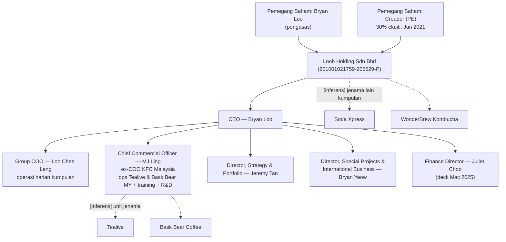
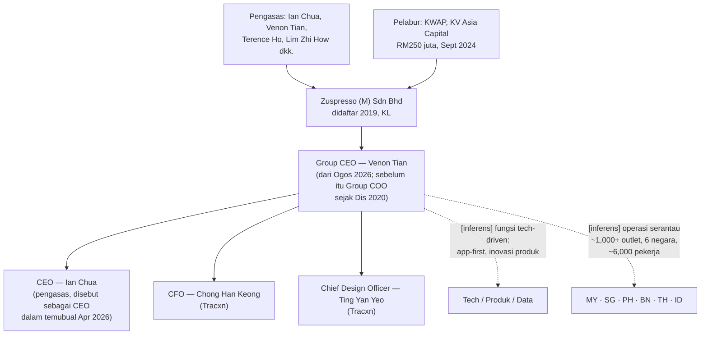
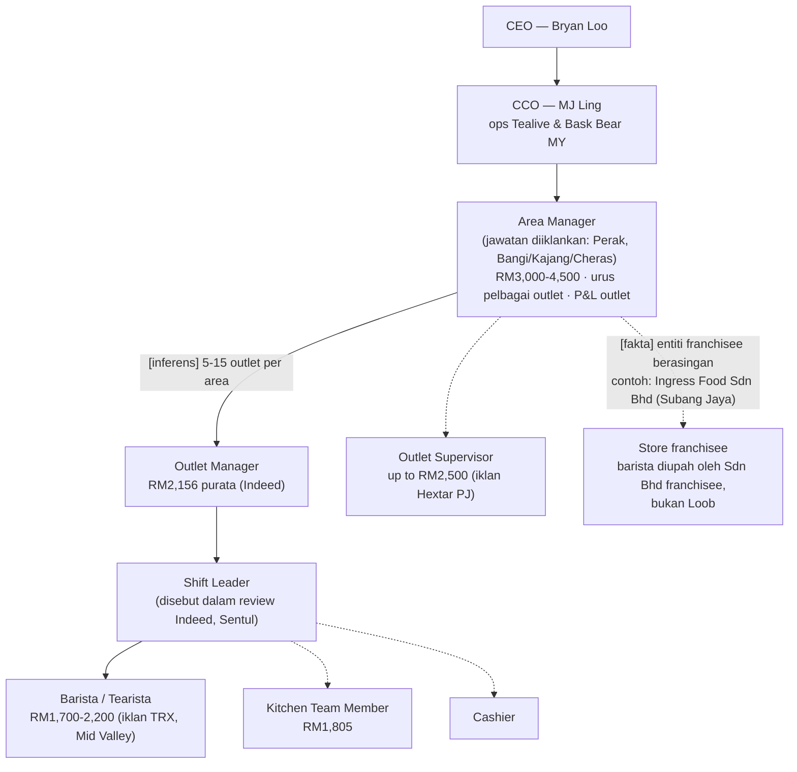
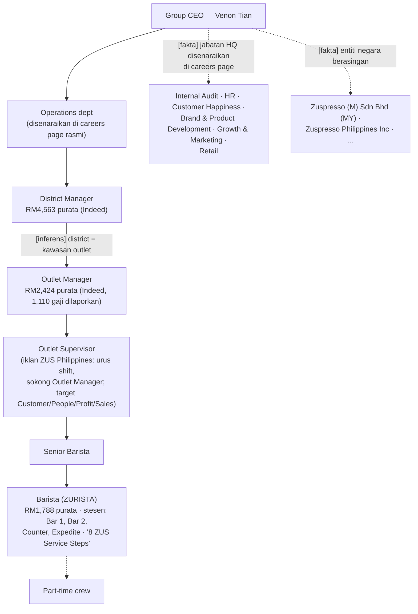

# Org Chart: Loob Holding (Tealive) & ZUS Coffee (Zuspresso)

Tarikh: 21 Okt 2026 · Sumber: deck korporat rasmi Tealive (Mac 2025), laman rasmi, LinkedIn, Tracxn, Wikipedia, Tatler.
**Nota**: struktur dalaman penuh tidak didedahkan awam — rajah menunjukkan lapisan yang disahkan sahaja; kotak [inferens] ialah susunan logik, bukan fakta.

---

## 1. Loob Holding Sdn Bhd (Tealive, Bask Bear, Soda Xpress, WonderBrew)

Bukti: deck korporat "Tealive International Brand Deck" Mac 2025 (senior leadership team eksplisit); loob.com.my/our-executive-team; Crunchbase (nota: Crunchbase senaraikan Mei Ling Toh sebagai CFO — bercanggah dengan deck Mac 2025 (Juliet Choo, Finance Director); kemungkinan perubahan penggabungan/era berbeza — **tidak disahkan**).

## 2. Zuspresso (M) Sdn Bhd (ZUS Coffee)

Bukti: LinkedIn Venon Tian (timeline jawatan: Group CEO mulai Ogos 2026); Tracxn (founders, CFO, CDO); Wikipedia (founders); Tatler Asia (1,000+ outlet, 6,000 pekerja); Business Today (RM250 juta); unienrol (Ian Chua CEO, temubual Apr 2026).

## 3. Perbandingan ringkas

| Aspek | Loob/Tealive | ZUS/Zuspresso |
|---|---|---|
| Model leadership | Founder-CEO + COO keluarga (adik-beradik Loo) + CCO veteran QSR | Duo founder (CEO/Group CEO) + kepimpinan luar industri (tech) |
| Struktur jenama | Multi-brand eksplisit bawah satu induk | Satu jenama, multi-negara |
| Pelabur institusi | Creador 30% (2021) | KWAP + KV Asia (2024) |
| Pengembangan | Master franchise serantau | Korporat langsung (tiada franchise tradisional) |

---

## 4. Org chart expanded sampai ke store (lanjutan 21 Okt 2026)

Sumber store-level: iklan jawatan sebenar (Indeed, Maukerja, Hiredly, PhilJobNet) + halaman careers rasmi ZUS. Jawatan dan gaji adalah **sourced**; garisan hierarki antara jawatan adalah **inference** melainkan dinyatakan dalam iklan (contoh: iklan ZUS PH menyatakan Outlet Supervisor "support the Outlet Manager").

### 4.1 Loob Holding → Store (Tealive)

Jawatan disahkan wujud melalui iklan: Barista (22 iklan Loob di Indeed), Outlet Manager (15), Outlet Supervisor, Shift Leader (review pekerja), Area Manager (iklan rasmi, RM3,000–4,500, "managing multiple outlets operations", "outlet sales performance & outlet costing (P&L)").

### 4.2 ZUS Coffee → Store (Zuspresso)

**Laluan kerjaya ZUS yang disahkan** (testimoni pekerja di careers page): Barista → **outlet supervisor trainee** → Outlet Supervisor ("Saya bermula sebagai barista biasa dan kini menyelia outlet Plaza Pandan Malim") → Outlet Manager → District Manager (jawatan wujud di Indeed).

### 4.3 Perbandingan store-level

| Lapisan | Tealive | ZUS Coffee |
|---|---|---|
| Multi-outlet | Area Manager (RM3.0–4.5k) | District Manager (RM4.6k purata) |
| Kepala outlet | Outlet Manager + Outlet Supervisor | Outlet Manager + Outlet Supervisor (co-supervisor disebut dalam iklan PH) |
| Shift | Shift Leader | Supervisor urus shift (opening/operating/closing) |
| Barisan | Barista/Tearista + Kitchen Team + Cashier | Barista + Senior Barista + part-time crew; stesen standard (Bar 1/2, Counter, Expedite) |
| Gaji barista | RM1,700–2,200 | RM1,788 purata |
| Entiti penggaji | Loob Sdn Bhd **atau** Sdn Bhd franchisee (contoh: Ingress Food) | Entiti per negara (Zuspresso M Sdn Bhd, Zuspresso Philippines Inc) |
