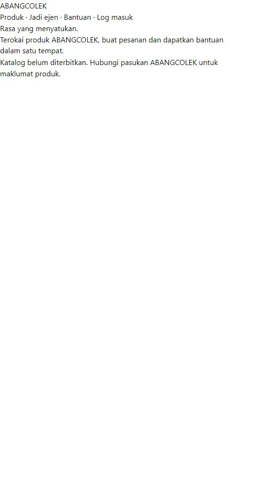

<!-- ABANGCOLEK-CURRENT-STATUS:BEGIN -->
> **Alignment20Oktober2026:** [Status semasa](../../../docs/CURRENT-STATUS.md) · [Checklist](../../../PROJECT-CHECKLIST.md). Rekod historical; pemerhatian, angka ujian, tick dan executor dalam badan asal merujuk sesi asal sahaja. Arahan launch/delegation lama tidak aktif. Status semasa dan bukti release ditentukan oleh rujukan di atas; kandungan asal dipelihara untuk provenance.
<!-- ABANGCOLEK-CURRENT-STATUS:END -->

<!-- blueprint-alignment: 2026-10-19 -->
> **Penyelarasan autoriti — 19 Oktober 2026.** REKOD SEJARAH / RUJUKAN — pemerhatian, metrik ujian, status deployment, harga/model dan cadangan di bawah terikat kepada tarikh serta skop asal. Ia bukan checklist execution semasa atau pengesahan bahawa dapatan masih benar. Kekalkan bukti asal; revalidate sebelum mendakwa fixed, connected atau production-ready.
>
> Rujukan semasa: [Master Growth Blueprint](../../../docs/ABANGCOLEK-MASTER-GROWTH-BLUEPRINT.md) dan [prompt pelaksanaan canonical](../../../docs/prompts/IMPLEMENT-ABANGCOLEK.md). Blueprint menetapkan 10 kemampuan CopilotKit, 10 modul bisnes, 32 kemampuan tool dan tujuh pendekatan Generative UI sebagai skop sasaran, bukan status siap. Polisi free-only melarang paid fallback; local rules bukan native model, approval bukan execution dan transaksi cloud memerlukan durable CAS commit. Senarai skill, MCP atau plugin bukan bukti ia tersedia atau aktif. Kemas kini dokumentasi ini tidak menjalankan ujian aplikasi, benchmark model, migrasi atau deployment.

# Diagnosis production ABANG-COLEK-V1 — 18 Oktober 2026

## Identiti yang disahkan

- Repo: https://github.com/thisisniagahub/ABANG-COLEK-V1
- Remote main: `a3f38bb1e88a03530301da7f473e4fb088db230c`, sama dengan HEAD lokal. Commit: Complete ABANGCOLEK landing brand polish.
- Domain homepage dalam metadata GitHub: https://abangcolek.gangniaga.my
- Project yang pengguna berikan: https://vercel.com/niaga-hub-pro/abang-colek-v1
- Status Vercel pada commit: success, Deployment has completed. Details: https://vercel.com/niaga-hub-pro/abang-colek-v1/9xC5ZFeQCutegdn2Eu4oo7r7ac7K
- Browser dashboard Vercel redirect ke login; CLI Vercel logged out. Environment settings dan build logs dalam dashboard belum dapat diperiksa. Tiada env atau deployment diubah.

Rujukan `abangcolek-os.vercel.app` dalam `src/services/vercelDeploy.ts` bukan sasaran production repo ini. Dapatan visual bagi domain lama dalam laporan terdahulu tidak patut digunakan untuk menilai UI semasa.

## Bukti domain yang betul



Screenshot disimpan daripada browser pada run ini. Paparan hanya teks header/navigation, heading Rasa yang menyatukan, penerangan dan notis katalog kosong. Design React penuh tidak muncul.

## 1. P1 — Supabase key kosong dalam bundle production

Console browser mengesahkan:

```text
Error: supabaseKey is required.
at new k1 (https://abangcolek.gangniaga.my/assets/index-BJ2bYBZu.js:231:57227)
at C1 (https://abangcolek.gangniaga.my/assets/index-BJ2bYBZu.js:231:61069)
at https://abangcolek.gangniaga.my/assets/index-BJ2bYBZu.js:231:61633
```

GET bundle berstatus 200, 496948 aksara. Pemeriksaan tanpa mencetak key mengesahkan property `publishableKey` mempunyai nilai string kosong. Expected Supabase host wujud. Nama `VITE_SUPABASE_ANON_KEY` tiada dalam bundle yang sudah dikompilasi.

Source `src/services/supabaseClient.ts:11` fallback kepada string kosong, dan baris 17 terus menjalankan `createClient` pada module scope. `AppRouter.tsx:16` mengimportnya; import router pada `main.tsx:8` berlaku sebelum React mount. Oleh itu error boundary React tidak memulihkan import failure tersebut.

**Kesimpulan disahkan:** key yang dibenamkan ketika build ialah kosong. Sama ada env tiada, kosong, tersalah nama atau tersalah environment scope dalam dashboard masih perlu disemak selepas login; jangan mendakwa pilihan tertentu telah disahkan.

**Tindakan:** semak `VITE_SUPABASE_URL` dan `VITE_SUPABASE_ANON_KEY` pada Production build environment project yang betul, dengan publishable/anon key yang sesuai untuk client. Bina dan deploy semula selepas pembetulan. Jangan gunakan service-role/secret key dalam client. Tambah config validation dan UI integration-unavailable supaya kegagalan satu integration tidak menggagalkan semua public routes.

## 2. P1 — API platform tidak tersedia pada domain production

| Request | Status | Content type | Hasil |
|---|---|---|---|
| `/` | 200 | text/html | HTML prerender/fallback; JS asset wujud |
| `/api/platform/session` | 404 | text/plain | Vercel NOT_FOUND |
| `/api/platform/catalogue` | 404 | text/plain | Vercel NOT_FOUND |
| `/public-catalogue.json` | 200 | application/json | version 0, products kosong |

Source menyokong masalah deployment boundary: `vercel.json` menetapkan output statik `dist` dan SPA rewrite, tanpa routing/proxy kepada API Bun. `package.json` memisahkan `build` daripada `server`; backend sebenar ialah `server/index.ts`. `vite.config.ts` hanya memberi proxy `/api/platform` pada development server. Tiada direktori serverless `api/` ditemui dalam repo semasa.

**Kesan:** selepas key diperbetulkan sekalipun, session/catalogue masih memerlukan backend yang betul. Kehadiran Supabase client tidak secara automatik menyediakan endpoint first-party Bun.

**Tindakan:** deploy runtime backend dengan persistence yang sesuai, kemudian route `/api/platform/*` kepada backend itu; atau adaptasi secara sengaja kepada platform hosting yang menyokong runtime tersebut. Jangan menganggap output `dist` menjalankan proses Bun/SQLite. Selepas itu sahkan JSON response, cookie/session, allowed origins dan persistence melalui journey sebenar.

## 3. P2 — Snapshot katalog build mengandungi 0 produk

`/public-catalogue.json` memulangkan version 0, productCount 0, generatedAt `2026-10-18T02:53:46.112Z` (10:53:46 MYT).

`scripts/prerender-public.ts` bermula dengan snapshot kosong dan membaca SQLite hanya jika fail database wujud di build environment. `var/` berada dalam `.gitignore`. Ini menerangkan kenapa static prerender boleh dibina tanpa produk. Data source sebenar Vercel belum dapat diperiksa.

`scripts/public-html.ts:13` menjana markup ringkas yang dilihat dalam browser; React sepatutnya mengambil alih apabila runtime berjaya. Oleh sebab startup JS gagal, markup fallback terus kelihatan. Ini bukan bukti bahawa komponen design React dibuang.

**Tindakan:** tentukan sumber published catalogue production yang eksplisit dan selamat; sync/export public projection tanpa memasukkan database operasi atau rahsia ke Git. Bezakan katalog kosong daripada sumber tidak boleh dicapai dan rebuild/sync selepas published data berubah.

## 4. P2 — GitHub Actions terhalang billing sebelum job bermula

Deploy run: https://github.com/thisisniagahub/ABANG-COLEK-V1/actions/runs/39091687617

GitHub check annotations untuk deploy `117569604359` dan Linux CI `117569604137` menyatakan:

```text
The job was not started because your account is locked due to a billing issue.
```

Deploy job mempunyai steps kosong. Kegagalan ini bukan bukti lint/test/build telah dijalankan dan gagal. Status deployment Vercel yang success ialah signal berasingan daripada dua GitHub Actions checks ini.

**Tindakan:** owner menyelesaikan sekatan billing GitHub, kemudian jalankan semula checks. Semak juga sasaran workflow: command menggunakan `--project niaga-hub-pro`, sedangkan URL project sebenar ialah team `niaga-hub-pro` / project `abang-colek-v1`. Command belum sampai execution dalam run ini, jadi mismatch itu bukan punca failure yang sedang dilaporkan; sahkan CLI linking/team/project sebelum rerun deployment.

## Keutamaan pemulihan dan acceptance

1. Betulkan build-time Supabase configuration dan startup failure.
2. Sediakan API backend production dan route yang betul.
3. Sambungkan published catalogue production.
4. Pulihkan GitHub CI selepas owner membetulkan billing; sahkan workflow deployment target.
5. Uji `/`, products, login, session, customer cart dan receipt pada domain yang betul, termasuk mobile/desktop; baru sambung keputusan visual audit.

Pemeriksaan ini read-only terhadap repo remote dan production. Tiada key, billing, deployment, akaun atau rekod bisnes diubah. Diagnosis tidak mendakwa backend/deployment telah dibaiki.
