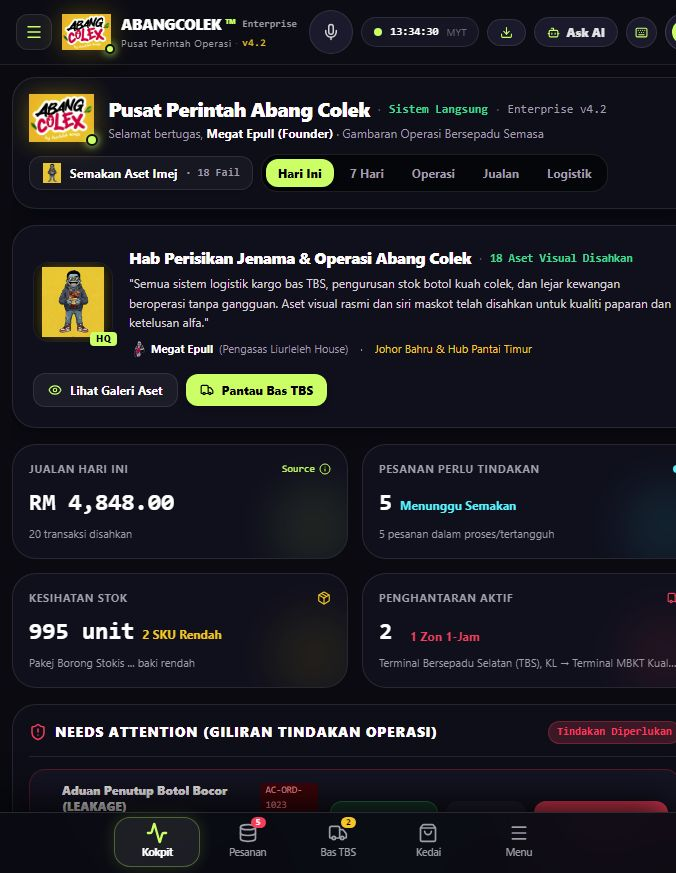

<!-- ABANGCOLEK-CURRENT-STATUS:BEGIN -->
> **Alignment20Oktober2026:** [Status semasa](../../../docs/CURRENT-STATUS.md) · [Checklist](../../../PROJECT-CHECKLIST.md). Rekod historical; pemerhatian, angka ujian, tick dan executor dalam badan asal merujuk sesi asal sahaja. Arahan launch/delegation lama tidak aktif. Status semasa dan bukti release ditentukan oleh rujukan di atas; kandungan asal dipelihara untuk provenance.
<!-- ABANGCOLEK-CURRENT-STATUS:END -->

<!-- blueprint-alignment: 2026-10-19 -->
> **Penyelarasan autoriti — 19 Oktober 2026.** REKOD SEJARAH / RUJUKAN — pemerhatian, metrik ujian, status deployment, harga/model dan cadangan di bawah terikat kepada tarikh serta skop asal. Ia bukan checklist execution semasa atau pengesahan bahawa dapatan masih benar. Kekalkan bukti asal; revalidate sebelum mendakwa fixed, connected atau production-ready.
>
> Rujukan semasa: [Master Growth Blueprint](../../../docs/ABANGCOLEK-MASTER-GROWTH-BLUEPRINT.md) dan [prompt pelaksanaan canonical](../../../docs/prompts/IMPLEMENT-ABANGCOLEK.md). Blueprint menetapkan 10 kemampuan CopilotKit, 10 modul bisnes, 32 kemampuan tool dan tujuh pendekatan Generative UI sebagai skop sasaran, bukan status siap. Polisi free-only melarang paid fallback; local rules bukan native model, approval bukan execution dan transaksi cloud memerlukan durable CAS commit. Senarai skill, MCP atau plugin bukan bukti ia tersedia atau aktif. Kemas kini dokumentasi ini tidak menjalankan ujian aplikasi, benchmark model, migrasi atau deployment.

# ABANGCOLEK UI/UX Review — 18 Oktober 2026

> **Pembetulan sasaran production:** semakan GitHub secara live selepas laporan asal mengenal pasti homepage repo `https://abangcolek.gangniaga.my` dan project Vercel `niaga-hub-pro/abang-colek-v1`. Domain `abangcolek-os.vercel.app` di bawah ialah rujukan lama. Dapatan visual V1–V4 hanya terpakai pada deployment lama itu dan **dikecualikan daripada penilaian UI production repo semasa**. Lihat `PRODUCTION_DIAGNOSIS.md` untuk bukti dan diagnosis domain yang betul. Jangan gunakan screenshot lama sebagai acceptance baseline.

## Status dan skop

**Status: semakan source selesai untuk skop yang disenaraikan; audit visual dan interaksi menyeluruh masih PARTIAL.**

Review ini menggunakan current working tree `D:\ABANGCOLEK-PLATFORM`, termasuk perubahan belum commit pada commerce/cart dan flows. Dua pemeriksaan source dijalankan secara berasingan: customer/landing/flows dan workspace/operasi. Tiada source aplikasi diedit. Tiada pesanan, approval, pembayaran atau akaun dicipta melalui UI.

Dua sasaran didapati berbeza:

- **Lokal `http://127.0.0.1:3000/`:** entrypoint `src/main.tsx` menggunakan `features/platform/AppRouter`. HTML berjaya dimuat, tetapi browser memaparkan putih kosong. Console mengesahkan `Error: supabaseKey is required.` pada import `services/supabaseClient.ts`. Checkout semasa dan private workspace belum boleh diuji secara visual.
- **Live `https://abangcolek-os.vercel.app/`:** URL ditemui dalam `src/services/vercelDeploy.ts:38`, kemudian dibuka dalam browser pada run ini. Ia merender dashboard operasi Enterprise v4.2, dengan header, KPI, action queue, logistics radar dan bottom navigation. Kandungannya berbeza daripada router dan dashboard source semasa. Screenshot deployment ini **bukan** bukti rendering working tree semasa. Commit deployment tidak dikenal pasti.

Tiada skor numerik keseluruhan diberikan kerana skrin, breakpoint dan journey yang penting belum semuanya boleh disahkan.

## Urutan pemeriksaan dan kesihatan setiap langkah

| Langkah | Pemeriksaan | Status |
|---|---|---|
| 1 | Buka home lokal; semak DOM dan console | **Blocked:** root React kosong, import Supabase gagal |
| 2 | Buka dashboard live yang tercatat dalam projek | **Boleh dilihat:** screenshot dan accessibility tree diperoleh; deployment berbeza |
| 3 | Semak hierarchy dan clipping pada viewport asal 676 × 873 | **Bermasalah:** kandungan kanan terpotong; kepadatan teks tinggi |
| 4 | Buka menu operasi live melalui kawalan bernama | **Tidak disahkan:** automation timeout; pemeriksaan berikutnya tidak menunjukkan drawer terbuka. Ini bukan bukti butang rosak |
| 5 | Cuba viewport desktop 1440 × 1000 | **Tidak disahkan:** override diterima, capture timeout. Viewport kemudian di-reset |
| 6 | Jejak public catalogue → authentication → order review → receipt | **Source sahaja:** live checkout current tree terhalang pada langkah 1 |
| 7 | Jejak cart, complaint, task collaboration, forms dan search | **Source sahaja:** logic diperiksa tanpa mutation rekod |

## Bukti visual yang diterima

### E0 — Lokal: startup gagal

Fail yang disimpan dibuka semula dan disahkan putih kosong. Lihat `local-console-errors.json` untuk petikan stack import yang diperhatikan melalui browser dev.logs pada run ini. Petikan ditranskripsi daripada output pemeriksaan kerana eksport selepas browser runtime reset memulangkan array kosong; ia bukan eksport console lengkap. Ini ialah bukti blocker, bukan screenshot reka bentuk halaman yang berjaya dirender.

### E1 — Live: dashboard pada viewport asal

Fail yang disimpan dibuka semula. Screenshot menunjukkan topbar dan sisi kanan card terpotong pada tepi viewport, banner aset di atas KPI, teks sokongan kecil, dan bottom navigation. DOM mengesahkan `documentElement.clientWidth`, `documentElement.scrollWidth` dan `body.scrollWidth` masing-masing 676; ukuran itu tidak menafikan clipping dalam container dalaman. Punca CSS deployment belum disahkan.

Accessibility tree disimpan di `live-dashboard-accessibility.txt`. Ia menyokong struktur dan label yang diperhatikan, tetapi tidak membuktikan keyboard operability atau screen-reader experience penuh.

## A. Dapatan visual pada deployment live

### V1 — P1: kandungan terpotong pada lebar sederhana

**Bukti:** E1, langkah 3. Header kanan, hujung banner dan card kanan berterusan melepasi tepi tangkapan. Maklumat status dan kawalan boleh menjadi sukar dicapai.

**Cadangan:** pastikan header boleh wrap atau beralih ke menu yang lebih ringkas; child grid menggunakan ruang sebenar container, teks mempunyai `min-width:0`, dan action group tidak memaksa lebar minimum yang melebihi ruang. Jangan sembunyikan overflow untuk menutup masalah. **Penerimaan:** pada 390, 430, 676, 768 dan 1024px semua label/kawalan utama boleh dilihat dan digunakan; 200% zoom tidak memotong tindakan.

### V2 — P2: kandungan aset/jenama mendahului keutamaan operasi

**Bukti:** E1, langkah 2–3. Selepas tajuk dashboard ada butang semakan 18 aset dan banner besar tentang maskot, pengasas serta aset visual; KPI bermula selepas bahagian tersebut, manakala action queue bermula hampir bawah viewport.

**Kesan:** operator perlu menapis kandungan editorial sebelum mengetahui kerja yang mendesak.

**Cadangan:** susun ringkasan tindakan mendesak → KPI → queue → logistik/timeline. Alihkan galeri aset ke Brand/Marketing; ringkaskan pengenalan kepada satu baris jika perlu.

### V3 — P2: terlalu banyak teks sokongan kecil dalam first screen

**Bukti:** E1. Header metadata, caption KPI, status dan banner menggunakan hierarki rapat; teks kelabu kecil memerlukan usaha membaca lebih tinggi pada paparan sempit. Ini pemerhatian visual, **bukan ukuran contrast ratio**.

**Cadangan:** hadkan metadata awal, gunakan body 14–16px sebagai titik mula, jadikan jumlah/status/next action paling jelas, dan uji actual contrast bagi kedua-dua tema. Nama order/outlet lebih utama daripada slogan teknikal.

### V4 — P2: label berautoriti memerlukan provenance yang mudah difahami

**Bukti:** accessibility tree live mengandungi “Sistem Langsung”, “20 transaksi disahkan” dan pernyataan semua sistem beroperasi tanpa gangguan. Screenshot turut menunjukkan label “Source” pada KPI.

**Batas:** sumber, freshness dan kebenaran data tersebut tidak disahkan; tidak boleh menyimpulkan data palsu atau benar daripada paparan sahaja.

**Cadangan:** tampilkan tempoh data, masa sync terakhir, sumber dan keadaan stale/degraded berdekatan KPI. Gunakan “disahkan” hanya apabila pengguna boleh menyemak bukti pengesahan.

## B. Blocker current working tree

### R1 — P1: satu integration config menjadikan seluruh app putih kosong

**Disahkan browser + source.** `src/services/supabaseClient.ts:13-17` menggunakan key kosong apabila env tiada lalu memanggil `createClient()` pada module scope. `src/features/platform/AppRouter.tsx:16` mengimport modul ini secara terus. `src/main.tsx:8` mengimport router sebelum error boundary dapat dirender. Hanya `.env.example` ditemui; tiada env lokal aktif atau env proses Supabase ditemui dalam pemeriksaan ini.

**Kesan:** pengguna tidak mendapat home, login, arahan pemulihan atau retry. React boundary tidak dapat menangkap kegagalan import yang berlaku sebelum mount.

**Cadangan:** konfigurasi deployment/local yang sah dan pengendalian integration unavailable yang tidak meruntuhkan laluan lain. Paparkan mesej yang boleh diambil tindakan, tanpa membocorkan key. **Penerimaan:** tanpa config optional, public page dan laluan yang tidak memerlukan integration masih boleh dibuka; Google login mempunyai penjelasan unavailable yang jelas.

## C. Customer journey — disahkan melalui source, belum live

### C1 — P1: troli boleh tersekat apabila stok atau pack berubah

**Bukti:** `src/features/workspaces/commerce.tsx:25-31,67-71`. Minus menjalankan validator stok/pek yang sama seperti plus; remove terus hanya disediakan bagi produk yang tiada dalam katalog.

**Contoh:** cart 12 unit, pek 6, stok baharu 3. Minus cuba 6 lalu ditolak; plus disabled; checkout disabled. Pengguna tidak boleh mengosongkan row itu melalui kawalan yang tersedia.

**Cadangan/penerimaan:** setiap item ada Buang; kuantiti invalid mempunyai sebab dan jalan pembetulan; pengguna sentiasa boleh mengurangkan atau membuang item ketika stok turun atau pek berubah.

### C2 — P1: pickup tanpa pemilihan lokasi

**Bukti:** `server/platform/flows.ts:8,15`, `server/platform/commerce.ts:71`, `src/features/landing/LandingPage.tsx:147`. Flow meminta fulfilment tetapi tiada outlet picker; server menggunakan `hq` jika `outletId` tidak diberi.

**Kesan:** apabila lebih satu pickup location tersedia, pelanggan boleh menyangka ia memilih lokasi yang dilihat pada halaman lokasi sedangkan order menggunakan HQ.

**Cadangan:** pilih lokasi approved, tunjuk alamat dan waktu; ulang pilihan pada review dan receipt. Jika hanya HQ, nyatakan HQ dengan jelas sebelum hantar.

### C3 — P2: dua purchase journey yang tidak bersambung

**Bukti:** `src/features/landing/LandingPage.tsx:97` terus membuka `/flows/order?product=...`; `src/features/flows/flow-answers.ts:5` menghasilkan satu line. Cart pelbagai produk hanya muncul di `/customer/shop` (`commerce.tsx:10`).

**Cadangan:** satu cart yang konsisten dari public catalogue ke login dan checkout, dengan Tambah produk lain, Edit troli dan item count yang jelas.

### C4 — P2: default kuantiti menghasilkan validation error bagi produk berpek

**Bukti:** `src/features/flows/FlowRenderer.tsx:60,146-147`, `FlowForm.tsx:29`, `flow-answers.ts:4`. Default 1 dan step 1 berbeza daripada validator gandaan pack.

**Cadangan:** default satu pek, step saiz pek, label “1 pek = 6 unit”, dan subtotal berdekatan kawalan. Menerima default UI mesti menghasilkan input sah apabila stok mencukupi.

### C5 — P2: quote tamat tanpa tindakan pemulihan yang jelas

**Bukti:** `server/platform/commerce.ts:65`, `server/platform/flows.ts:41`, `src/features/flows/FlowRenderer.tsx:99,136,159`. Quote 15 minit; selepas expiry, error tidak membatalkan `reviewVersion` atau menyediakan requote CTA.

**Cadangan:** tunjuk expiry; apabila `REQUOTE_REQUIRED`, tukar kepada Semak harga semula dengan semua pilihan dikekalkan. Jangan biarkan submit yang sama mengulang error tanpa jalan keluar.

### C6 — P2: tukar paparan menyebabkan input belum disimpan hilang

**Bukti:** `FlowRenderer.tsx:132,135`, `FlowForm.tsx:26,29-30`. Dua paparan menggunakan state/default values yang tidak dikongsi, dan form unmount apabila toggle.

**Cadangan:** satu draft state untuk perbualan dan form; menukar paparan atau kembali tidak membuang input yang telah ditaip.

### C7 — P2: aduan meminta ID pesanan mentah

**Bukti:** `FlowRenderer.tsx:17,25,154`, `FlowForm.tsx:30`. Guided input untuk `orderId` ialah text walaupun orders sudah dimuat dan form alternatif mempunyai selector.

**Cadangan:** order picker dengan nombor ringkas, produk, tarikh dan status; preselect apabila datang daripada order detail.

### C8 — P2: error katalog boleh kelihatan seperti katalog kosong

**Bukti:** `FlowRenderer.tsx:128,146-148`. Error dan retry hanya dirender untuk cart lines, sedangkan laluan `?product=` boleh memaparkan “Katalog belum diterbitkan” ketika request gagal.

**Cadangan:** bezakan loading, tiada produk, produk tidak tersedia dan network error, dengan retry untuk setiap laluan.

### C9 — P2: pilihan produk halaman kedua tidak diselesaikan secara automatik

**Bukti:** `LandingPage.tsx:100`, `FlowRenderer.tsx:57,65,112`, `server/platform/app.ts:52-56`. Auto-pagination checkout mengendalikan cart lines, bukan preferred product query. Bersyarat pada katalog melebihi 100 produk.

**Cadangan:** fetch produk pilihan melalui endpoint khusus; jangan minta pelanggan mencari produk yang sudah dipilih melalui Muat lagi.

### C10 — P3: orientasi heading dan bahasa boleh diperbaiki

**Bukti:** `LandingPage.tsx:73,91,122,156`. Products, product detail, dealer dan help tidak mempunyai H1 khusus. Copy juga kerap menggunakan “published”, “authorized operator”, “ownership & custody”, version dan receipt dalam customer-facing explanations.

**Cadangan:** H1 mengikut tujuan halaman; nama produk sebagai H1 detail. Gunakan BM/English yang mudah: pesanan, bukti bayaran, lokasi ambil dan semakan; technical identifiers berada dalam butiran tambahan apabila berguna.

## D. Workspace operasi — disahkan melalui source, belum live

### W1 — P1: gangguan session sementara boleh membuang draft

**Bukti:** `AppRouter.tsx:79-83,98-103,136`, `client.ts:61-62`, `workspaces/ui.tsx:48-64`. Window focus memanggil session refresh; sebarang exception menetapkan session null, menyebabkan workspace/form unmount.

**Cadangan:** bezakan auth expired daripada network/server unavailable. Kekalkan draft pada transient failure, paparkan status dan retry, serta minta reauthentication hanya apabila perlu.

### W2 — P1: checklist refresh membuang comment/outcome belum disimpan

**Bukti:** `workspaces/work.tsx:41-54`, `platform/client.ts:83-86`. Reload menetapkan data null; forms bergantung pada `task` dan keyed revision, lalu unmount/remount.

**Cadangan:** simpan draft di parent stabil, refresh tanpa mengosongkan successful snapshot. **Penerimaan:** taip outcome → check checklist → outcome masih sama; konflik revision memberi jalan recovery.

### W3 — P2: kerja biasa memerlukan internal ID dan format manual

**Bukti:** `work.tsx:38`, `operations.tsx:75,112-118`, `marketing.tsx:83-84`, `business.tsx:145-146`, `ReportBuilder.tsx:25-26`. Fields seperti Assigned user ID, Document IDs, Batch ID dan `nama|nilai|unit` memerlukan lookup/copy/paste.

**Cadangan:** searchable pickers berlabel nama/outlet, context prefill dan repeatable rows. Inline validation per row sebelum submit. IDs kekal sebagai metadata rujukan.

### W4 — P2: negative-test control meninggalkan onboarding dalam keadaan tidak boleh commit

**Bukti:** `ProductOnboarding.tsx:82-97,172-174,183-244,288-295`; `server/platform/onboarding.ts:47-52,114-115`. Test button menambah mascot invalid; tiada remove/reset. Satu rejected item menjadikan canCommit false.

**Cadangan:** alihkan negative test daripada UI operasi; tambah remove/undo per item. Jangan paksa reload yang membuang price edits untuk pulih.

### W5 — P2: search/filter hanya merangkumi halaman yang dimuat

**Bukti:** pagination `server/platform/app.ts:51-56,335`; filters `work.tsx:13-21,62-70,152-162`, `operations.tsx:11-15`, `marketing.tsx:25-34`. Array filter dibuat di client, sedangkan data page seterusnya belum dimuat.

**Cadangan:** server-side search/filter dan filtered counts; jika masih client-side, label skop carian dan jangan paparkan empty state muktamad selagi ada halaman lain. Uji dengan >100 rekod dalam fixture terasing.

### W6 — P2: global CSS menindih hierarchy button workspace

**Bukti source:** `platform-shell.css:3` selector `.platform-app button` mempunyai specificity lebih tinggi daripada `.xp-button`, `.xp-secondary`, `.xp-dark-secondary` pada `workspaces.css:103-132`. Background/color intended variants akan kalah apabila kedua-dua rule berkenaan terpakai. **Computed style live current tree belum diukur.**

**Cadangan:** base style berspecificity rendah dan semantic variants yang konsisten; primary, secondary dan destructive action dibezakan tanpa bergantung pada warna sahaja.

### W7 — P2: plugin layout mempunyai jurang breakpoint

**Bukti source:** `workspaces.css:916,1520,1599`, `PluginsWorkspace.tsx:39-42`. Outer grid dua columns dengan detail min 280px dan inner grid dua columns; mobile override hanya pada ≤400px.

**Risiko:** pada 401–767px cards/toolbar boleh terhimpit. Ini **belum disahkan screenshot**. Uji 430, 600 dan 768px; collapse berdasarkan ruang container, bukan menganggap 390px mewakili semua mobile.

### W8 — P2: navigation workspace kurang orientasi focus/title

**Bukti:** `AppRouter.tsx:77,147`, `WorkspaceNavigation.tsx:56-69`. SPA navigate tidak mengemas kini title per section atau focus heading baharu. Drawer cleanup memulangkan focus ke opener walaupun pengguna telah memilih destinasi.

**Cadangan:** title role/section, focus ke heading/main selepas navigation, dan pengumuman ringkas. Sahkan dengan keyboard dan screen reader; jangan anggap fokus trap drawer sahaja mencukupi.

## Kekuatan untuk dikekalkan

- Live: KPI besar mudah dikenal pasti; action queue, logistik dan timeline memberi pembahagian kerja yang berguna; bottom navigation menyediakan destinasi rutin.
- Current source: central dark/light tokens, focus-visible, 44px controls dan reduced-motion treatment sudah disediakan.
- Hero mempunyai pilihan statik/pause, skip ke catalogue, chapter labels dan live status; behavior sebenar masih perlu diuji.
- Workspace sidebar menggunakan anchor sebenar, aria-current, Escape, inert, focus trap dan focus return.
- Reusable forms mempunyai label, help text, native required constraints dan alert/status.
- Harga disemak server, quote/receipt membezakan permintaan diterima daripada payment/fulfilment verified, dan draft memerlukan opt-in.

## Susunan pembaikan yang dicadangkan

1. **Pulihkan akses dan lindungi input:** R1, W1, W2, C1.
2. **Lengkapkan purchase journey:** C2–C8, satukan catalogue/cart/auth, betulkan pek dan quote recovery.
3. **Mudahkan kerja operator:** W3–W5, keluarkan test controls dan kurangkan lookup manual.
4. **Rapikan visual dan accessibility:** V1–V4, W6–W8, C10; ukur semula pada semua breakpoint dan kedua-dua tema.

## Perkara yang belum boleh diputuskan

Belum disahkan: full customer checkout/receipt, OAuth callback sebenar, authenticated roles current tree, deployment commit parity, responsive 390/430/768/1440, light theme live, measured contrast, keyboard/screen-reader end-to-end, Core Web Vitals dan real-device touch. Browser automation timeout bukan bukti app crash atau bukti menu rosak. Tidak ada kelulusan WCAG atau production readiness diberikan.

Langkah seterusnya ialah menyediakan URL preview yang sepadan dengan current working tree, atau memulihkan konfigurasi lokal, kemudian melengkapkan capture dan ujian interaksi berdasarkan dapatan di atas.
